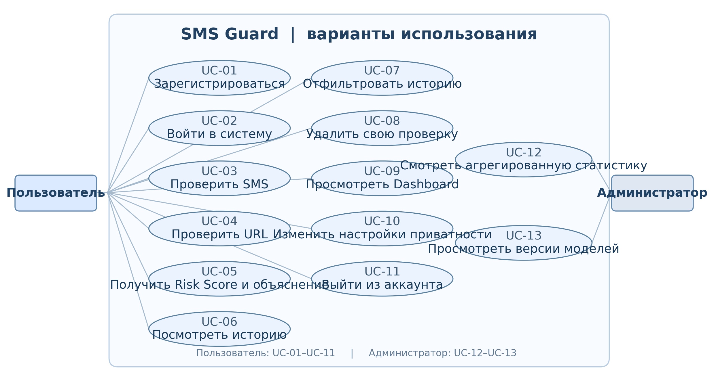

# Отчёт по заданию №1

**Учебное заведение:** Международный университет информационных технологий  
**Проект:** «Интеллектуальная система обнаружения мошеннических SMS-сообщений и подозрительных ссылок на основе методов искусственного интеллекта и машинного обучения»  
**Исполнители:** Арыстанов Мади, Тураров Алишер  
**Группа:** SIS-2305  
**Город, год:** Алматы, 2026  
**Название задания:** Анализ предметной области и проектирование системы

## 1. Постановка задачи и назначение системы

Цель проекта — создать веб-приложение **SMS Guard**, которое позволяет человеку самостоятельно оценивать подозрительные SMS-сообщения и ссылки. Текст анализируется методами NLP и ML; ссылки — по признакам, извлекаемым из строки URL, без открытия страниц. Система объединяет оценки, рассчитывает `Risk Score` от 0 до 100, показывает уровень риска, причины и рекомендацию. Классификация не является гарантией безопасности. [1]

**Предметная область.** Смишинг (smishing) — фишинг через текстовые сообщения. Мошенник может выдавать себя за банк, государственный сервис или службу доставки, добиваясь передачи секретных данных либо денег. Манипуляции строятся на срочности, страхе, авторитете, выгоде и секретности. Ссылки иногда ведут на поддельные страницы; поэтому необходим совместный анализ текста и структуры URL. [1], [6], [7]

**Граница проекта.** SMS Guard помогает принять решение пользователю, а не автоматически блокирует SMS на телефоне. URL анализируется **только как строка**: приложение не загружает страницу, не выполняет DNS-запросы и не переходит по редиректам. Роли в системе — «Пользователь» и «Администратор». [1]

## 2. Категории угроз и признаки социальной инженерии

Все примеры ниже **искусственные**, не содержат реальных персональных данных и используют зарезервированную зону `.example`; форма `hxxps://` предотвращает случайный переход.

| Категория | Искусственный пример SMS | Признаки социальной инженерии |
|---|---|---|
| Поддельный банк | «Служба банка: для подтверждения входа проверьте профиль на hxxps://bank-access.example» | Авторитет, доверие |
| Блокировка карты | «ВНИМАНИЕ! Ваша карта будет заблокирована через 20 минут. Срочно подтвердите данные!» | Страх, срочность |
| Выигрыш или приз | «Вы получили приз! Для оформления укажите данные в форме hxxps://reward-check.example» | Выгода, срочность |
| Служба доставки | «Посылка задержана. Оплатите небольшую пошлину сегодня: hxxps://delivery-status.example» | Авторитет, срочность |
| «Родственник в беде» | «Это я, пишу с чужого номера. Срочно переведи деньги, никому не звони!» | Страх, срочность, секретность |
| Запрос кода из SMS | «Сотрудник поддержки: назовите код подтверждения из последнего SMS, чтобы сохранить доступ» | Авторитет, страх |
| Поддельные госуслуги/штрафы | «У вас неоплаченный штраф. Во избежание взыскания откройте hxxps://fine-notice.example» | Авторитет, страх |
| Инвестиционное мошенничество | «Гарантированная прибыль 20% в неделю. Внесите депозит до конца дня!» | Выгода, срочность |

**Наблюдение.** Одна категория может сочетать несколько приёмов: например, «срочно подтвердите карту» одновременно использует авторитет банка, страх блокировки и ограничение времени. Поэтому в системе необходимы как лексические правила для групп признаков, так и вероятностная оценка ML-модели. [1]

## 3. Сравнение существующих решений

**ANY.RUN.** Интерактивная песочница: исследование URL и файлов в виртуальной среде, наблюдение за действиями страницы, скриптами, редиректами и сетевой активностью. **Преимущества:** Глубокий динамический анализ; отчёты и контекст для SOC-аналитика. **Ограничения для задачи SMS Guard:** Требует отправки объекта во внешнюю среду и интерпретации отчёта; это не специализированный проверяющий сервис для обычного текста SMS. Источник: [2].

**VirusTotal.** Сервис анализа URL, доменов и файлов, агрегирующий результаты множества проверяющих механизмов и источников репутации. **Преимущества:** Сопоставление нескольких вердиктов, отчёты по URL и API. **Ограничения для задачи SMS Guard:** Отсутствие детектирования не доказывает безопасность; общедоступные отправки/отчёты могут раскрывать сведения об исследуемом URL. Источник: [3], [4].

**Google Messages — Spam & scam protection.** Встроенная защита приложения для сообщений: распознавание спама и мошенничества, предупреждения, проверка URL по сервисам Google. **Преимущества:** Защита непосредственно в потоке сообщений; машинное обучение на устройстве. **Ограничения для задачи SMS Guard:** Привязана к экосистеме мессенджера; не заменяет отдельный учебный веб-инструмент с открытыми Risk Score, списком признаков и историей проверок. Источник: [5].

| Критерий | ANY.RUN | VirusTotal | Google Messages | SMS Guard (проект) |
|---|---|---|---|---|
| Основной объект | URL, файлы | URL, файлы, домены | Сообщения | SMS и URL |
| Подход | Динамический анализ | Агрегация детектов и репутации | Автоматическая антиспам-защита | Локальные ML-модели + правила |
| Нужна внешняя среда | Да, песочница | Да, сервис | Сервис в приложении | Нет для основного анализа |
| Проверка произвольного SMS | Не основной сценарий | Не основной сценарий | Внутри мессенджера | Да, текст в веб-форме |
| Пояснение риска | Поведенческие артефакты | Вердикты движков | Уведомление о подозрении | Risk Score, причины, совет |

**Вывод сравнения.** ANY.RUN полезен для детального расследования уже выявленной угрозы, VirusTotal — для проверки репутации IOC, Google Messages — для автоматической защиты в переписке. SMS Guard решает более узкую учебно-практическую задачу: объяснимую самостоятельную проверку **введённого SMS и найденных в нём URL** в одном веб-интерфейсе, без выполнения стороннего URL. Выводы основаны на открытой документации; экспериментального сравнения точности инструментов здесь не проводилось.

## 4. Целевая аудитория и роли

Целевая аудитория — пользователи мобильной связи, получающие сомнительные уведомления, а также студенты и начинающие специалисты по информационной безопасности, изучающие признаки социальной инженерии. В учебной эксплуатации предусмотрен администратор для агрегированной статистики. [1]

| Роль | Возможности и ограничения |
|---|---|
| **Пользователь** | Регистрация и вход; проверка SMS и URL; просмотр Risk Score, объяснений, истории и личной статистики; настройка согласия на хранение исходного текста. |
| **Администратор** | Доступ к агрегированной статистике по системе и статусам моделей без просмотра текстов чужих SMS; обычные проверки выполняет в рамках личного аккаунта. |

## 5. Use Case: сценарии использования

Редактируемый исходный код диаграммы — `diagrams/01_use_case.puml`; рисунок — схема тех же прецедентов. В модели **13 прецедентов** и **2 роли** (требование ТЗ: не менее 8).

| Код | Прецедент | Участник |
|---|---|---|
| `UC-01` | Зарегистрироваться | Пользователь |
| `UC-02` | Войти в систему | Пользователь |
| `UC-03` | Проверить SMS | Пользователь |
| `UC-04` | Проверить URL | Пользователь |
| `UC-05` | Получить Risk Score и объяснение | Пользователь |
| `UC-06` | Посмотреть историю | Пользователь |
| `UC-07` | Отфильтровать историю | Пользователь |
| `UC-08` | Удалить свою проверку | Пользователь |
| `UC-09` | Просмотреть Dashboard | Пользователь |
| `UC-10` | Изменить настройки приватности | Пользователь |
| `UC-11` | Выйти из аккаунта | Пользователь |
| `UC-12` | Смотреть агрегированную статистику | Администратор |
| `UC-13` | Просмотреть версии моделей | Администратор |

**Ключевой сценарий проверки SMS:** пользователь входит в систему → отправляет текст → backend выполняет нормализацию и поиск URL → модели вычисляют `P_sms` и `P_url` → модуль риска вычисляет итог → пользователь видит результат, причины и рекомендации → запись сохраняется с учётом согласия на хранение текста. [1]

## 6. Приоритизация требований (MoSCoW)

`Must` — критично для работоспособности и безопасности; `Should` — важно для финальной версии, но допустимо реализовать после ядра; `Could` — дополнительные функции. **Приоритет показывает последовательность разработки, а не отменяет обязанность выполнить требования ТЗ.** В ТЗ явно необязательны только внешний репутационный API и экспорт CSV. Коды `ФТ-4.*`–`ФТ-7.*` присвоены авторами отчёта как **рабочие**: исходное ТЗ кодирует непосредственно только `ФТ-1.*`–`ФТ-3.*`, но описывает и последующие модули без отдельных кодов.

| Код | Группа | Требование (кратко) | MoSCoW |
|---|---|---|---|
| `ФТ-1.1` | Аккаунты | Регистрация: логин 3–30, e-mail, пароль ≥8 (буквы и цифры). | **Must** |
| `ФТ-1.2` | Аккаунты | Уникальные логин и e-mail, понятная ошибка при повторе. | **Must** |
| `ФТ-1.3` | Аккаунты | Вход; после 5 ошибок — пауза не менее 60 с. | **Must** |
| `ФТ-1.4` | Аккаунты | Пароли: salted hash (PBKDF2 / bcrypt / Argon2). | **Must** |
| `ФТ-1.5` | Аккаунты | Выход аннулирует текущую сессию. | **Must** |
| `ФТ-1.6` | Аккаунты | Проверки, история, Dashboard, профиль — после входа. | **Must** |
| `ФТ-1.7` | Аккаунты | Доступ только к своим результатам; чужие ID → 403/404. | **Must** |
| `ФТ-1.8` | Аккаунты | Cookie HttpOnly, SameSite=Lax, Secure при HTTPS; CSRF. | **Must** |
| `ФТ-1.9` | Аккаунты | Администратор: общая статистика без чужих SMS. | **Should** |
| `ФТ-2.1` | SMS | SMS: 1–1000 символов; пустой и пробельный ввод отклонять. | **Must** |
| `ФТ-2.2` | SMS | Определять язык: ru, kk, en, other. | **Should** |
| `ФТ-2.3` | SMS | Нормализация и замена URL, телефона, чисел, сумм токенами. | **Must** |
| `ФТ-2.4` | SMS | TF-IDF как часть единого сохранённого pipeline. | **Must** |
| `ФТ-2.5` | SMS | Словарь ≥6 групп социальной инженерии. | **Must** |
| `ФТ-2.6` | SMS | ML-классификация с вероятностью P_sms ∈ [0,1]. | **Must** |
| `ФТ-2.7` | SMS | Автоматически анализировать до 3 URL, найденных в SMS. | **Must** |
| `ФТ-2.8` | SMS | Предупреждать о слабой языковой поддержке. | **Must** |
| `ФТ-3.1` | URL | URL: http/https или без схемы; длина ≤2048. | **Must** |
| `ФТ-3.2` | URL | Извлечение не менее 20 числовых признаков. | **Must** |
| `ФТ-3.3` | URL | Определение IPv4/IPv6 вместо домена. | **Must** |
| `ФТ-3.4` | URL | Подсчёт поддоменов, точек, дефисов, цифр и символов. | **Must** |
| `ФТ-3.5` | URL | HTTPS, нестандартный порт, @, // внутри пути. | **Must** |
| `ФТ-3.6` | URL | Распознавание ≥15 URL-сокращателей. | **Should** |
| `ФТ-3.7` | URL | Поиск подозрительных слов в URL. | **Should** |
| `ФТ-3.8` | URL | Punycode, смешение алфавитов, имитация брендов. | **Must** |
| `ФТ-3.9` | URL | ML-вероятность P_url; SAFE/SUSPICIOUS/DANGEROUS. | **Must** |
| `ФТ-3.10` | URL | URL показывать неактивным текстом, выделять домен. | **Must** |
| `ФТ-3.11` | URL | Внешний сервис репутации URL с таймаутом 3 с. | **Could** |
| `ФТ-4.1` | ML | SMS: сравнить ≥3 алгоритмов; URL: ≥2 алгоритмов. | **Must** |
| `ФТ-4.2` | ML | Сохранить обе модели с метаданными и версиями. | **Must** |
| `ФТ-4.3` | ML | Загружать модели один раз при запуске. | **Must** |
| `ФТ-5.1` | Риск | Risk Score 0–100 и низкий/средний/высокий риск. | **Must** |
| `ФТ-5.2` | Риск | Учитывать P_sms, max(P_url) и группы признаков. | **Must** |
| `ФТ-5.3` | Риск | Пороги и веса — в risk_config.yaml. | **Must** |
| `ФТ-5.4` | Риск | ≥1 причина, совет и вероятностное предупреждение. | **Must** |
| `ФТ-6.1` | Dashboard | Счётчики проверок, распределение категорий и риска. | **Must** |
| `ФТ-6.2` | Dashboard | График активности по дням за последние 30 дней. | **Should** |
| `ФТ-6.3` | Dashboard | Топ-5 признаков социальной инженерии. | **Should** |
| `ФТ-6.4` | Dashboard | 5–10 последних проверок с переходом к результату. | **Should** |
| `ФТ-7.1` | История | Хранить даты, тип, категорию, Score, оценки, версии. | **Must** |
| `ФТ-7.2` | История | Пагинация по 20, сортировка, фильтры. | **Should** |
| `ФТ-7.3` | История | Открыть детали и удалить свою запись. | **Must** |
| `ФТ-7.4` | История | Полный SMS — только при согласии; иначе маска. | **Must** |
| `ФТ-7.5` | История | Экспорт собственной истории в CSV. | **Could** |
| `НФТ-1` | Нефункциональные | Анализ SMS с ≤3 URL за ≤500 мс (без внешних API). | **Must** |
| `НФТ-2` | Нефункциональные | Dashboard с 1000 записей загружается за ≤2 с. | **Should** |
| `НФТ-3` | Нефункциональные | Двойная отправка формы не дублирует запись. | **Must** |
| `НФТ-4` | Нефункциональные | SQL только через ORM / параметризованные запросы. | **Must** |
| `НФТ-5` | Нефункциональные | Экранирование пользовательского ввода при выводе. | **Must** |
| `НФТ-6` | Нефункциональные | API: ≤30 проверок/мин на пользователя; HTTP 429. | **Must** |
| `НФТ-7` | Нефункциональные | Секреты — в .env; DEBUG=False в демонстрации. | **Must** |
| `НФТ-8` | Нефункциональные | Если есть загрузка: .txt/.csv ≤1 МБ, проверка, вне web-root. | **Should** |
| `НФТ-9` | Нефункциональные | Не записывать исходный текст SMS в журналы. | **Must** |
| `НФТ-10` | Нефункциональные | Адаптивность на ширине 360/768/1366 px. | **Should** |
| `НФТ-11` | Нефункциональные | Ошибки ввода на русском рядом с полем. | **Should** |
| `НФТ-12` | Нефункциональные | Некорректный ввод не должен вызывать HTTP 500. | **Must** |
| `НФТ-13` | Нефункциональные | Ротируемый logs/app.log: время, уровень, модуль. | **Should** |
| `НФТ-14` | Нефункциональные | При отсутствии модели — понятная деградация сервиса. | **Must** |
| `НФТ-15` | Нефункциональные | Покрытие ml/ и risk/ тестами ≥60% строк. | **Must** |

Полный машиночитаемый реестр — `01_requirements_moscow.csv`, включая исходность кодов. Критерии для каждого требования установлены в ТЗ; на этапе тестирования им будут сопоставлены тест-кейсы. [1]

## 7. Ограничения и риски проекта

- **Языковая применимость.** Основной набор UCI SMS Spam Collection англоязычный; поддержка `ru` и `kk` допустима лишь после отдельной оценки на размеченных примерах. Иначе результат текстовой модели помечается как менее надёжный. [1]
- **Ложные результаты.** `SAFE` не означает гарантированную безопасность, а `FRAUDULENT` не означает доказанный факт мошенничества; система даёт вероятностное заключение. [1]
- **Конфиденциальность.** Полный текст SMS сохраняется только по явному согласию; журналы приложения не должны содержать исходных SMS. Чужие проверки защищены разграничением доступа. [1]
- **Ограниченность URL-анализа.** Система не видит динамический контент страницы, но это осознанная граница безопасности и производительности; при необходимости расследования обращаются к специализированным инструментам вроде ANY.RUN. [1], [2]

## 8. Вывод и результат задания

В рамках проектирования выявлены **8 категорий** угроз с искусственными примерами и признаками социальной инженерии, сопоставлены **3 существующих решения**, определены **2 роли**, спроектированы **13 Use Case** и сформирован реестр из **59 требований** с кодами и приоритетами MoSCoW. Для SMS Guard обоснован подход двух независимых ML-моделей, общего Risk Score, объяснимых результатов, защиты персональных данных и хранения истории проверок. Следующим шагом будет создание воспроизводимого каркаса Django-проекта (задание №2).

## 9. Источники

[1] Техническое задание «Интеллектуальная система обнаружения мошеннических SMS-сообщений и подозрительных ссылок», разделы 1–3, 5, задание 1, с. 1–20.

[2] ANY.RUN. Interactive malware analysis sandbox for SOC teams. https://any.run/features/

[3] VirusTotal. How it works. https://docs.virustotal.com/docs/how-it-works

[4] VirusTotal. Scan URL (API v3). https://docs.virustotal.com/reference/scan-url

[5] Google Messages. How Google protects your privacy with spam and scam protection. https://support.google.com/messages/answer/9327903?hl=en

[6] NIST Computer Security Resource Center. Social engineering; phishing. https://csrc.nist.gov/glossary/term/social_engineering

[7] Canadian Centre for Cyber Security. Social engineering (smishing). https://www.cyber.gc.ca/en/guidance/social-engineering-itsap00166

**Дата обращения к публичным источникам:** 06.11.2026.
