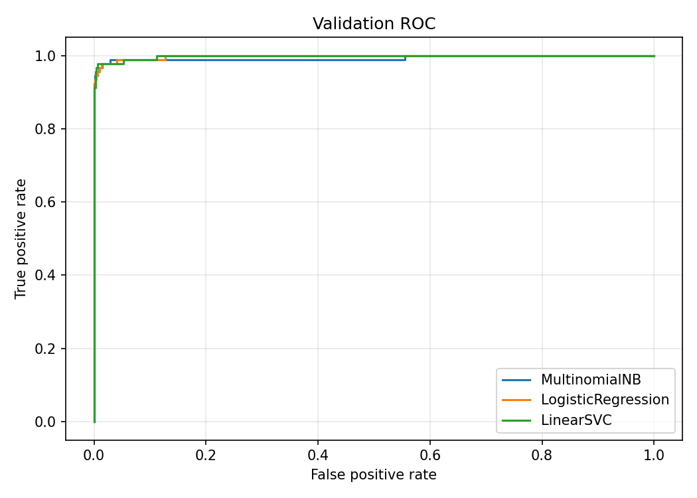
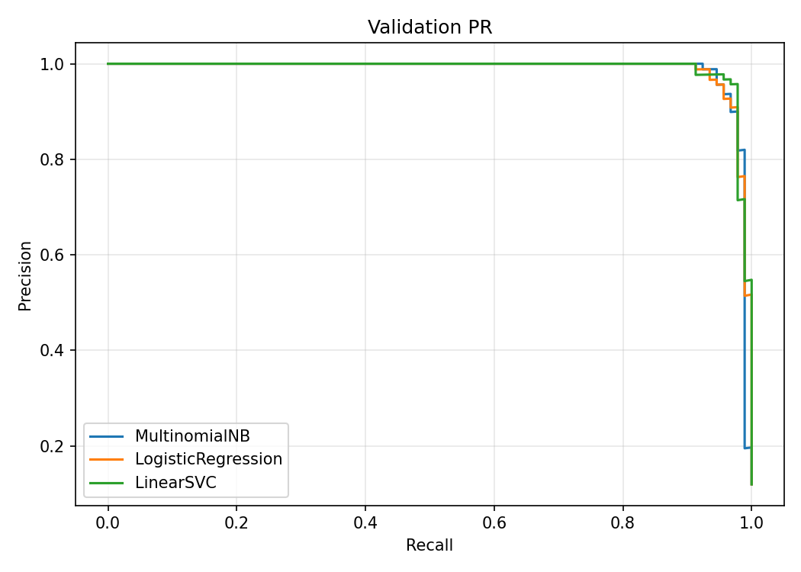

# Сравнение алгоритмов классификации SMS — задание №8

## Методика

Использовано прежнее разбиение sms_split.json: Train 3594 (433 spam), Validation 770 (92 spam), Test 771 (93 spam). Новое разбиение не создавалось. Пересечения индексов и дубликаты нормализованных текстов проверяются при загрузке.

GridSearchCV работает исключительно на Train: StratifiedKFold(5, shuffle=True, random_state=42), целевая метрика F2 для spam=1. Для каждого алгоритма проверены четыре конфигурации: слова / слова + char_wb(3,5), с удалением английских стоп-слов и без удаления. Словесные N-граммы (1,2), min_df=2, max_df=0.95. Шесть ручных признаков одинаковы во всех конфигурациях. Удаление стоп-слов затрагивает только словесный TF-IDF; символьная и ручная ветви получают прежний нормализованный текст.

Сетки: NB alpha=[0.1,0.5,1.0] — слабое/умеренное сглаживание; LR и SVC C=[0.1,1,10] — три порядка силы регуляризации. Для LR и SVC class_weight=balanced, random_state=42. LR: max_iter=3000; SVC: dual=False, max_iter=20000. В предварительном запуске dual='auto' дал предупреждения о несходимости; этот запуск остановлен до Test, затем сравнение повторено с решением прямой задачи. Все TF-IDF обучаются внутри folds. В LinearSVC CalibratedClassifierCV(method='sigmoid') охватывает полный Pipeline, поэтому даже внутренние folds калибровки имеют независимые словари и IDF. Внутренняя калибровка использует такой же пятиfoldовый стратифицированный splitter. Validation, Test и ru/kk не используются ни для GridSearchCV, ни для калибровки.

## Сравнение на Validation

Настройки каждого алгоритма выбираются по среднему CV F2 на Train. Основная таблица использует отдельный порог каждого алгоритма, выбранный на Validation. PR-AUC обозначает average_precision_score: AP без интерполяции, сумма приращений Recall, взвешенных Precision; это не трапецеидальная площадь.

| Алгоритм | Accuracy | Precision | Recall | F1 | F2 | ROC-AUC | PR-AUC (AP) | Fit, с | Поиск, с | 1 SMS, мс |
|---|---:|---:|---:|---:|---:|---:|---:|---:|---:|---:|
| MultinomialNB | 0.977922 | 0.857143 | 0.978261 | 0.913706 | 0.951374 | 0.993299 | 0.986814 | 0.861 | 72.654 | 5.260 |
| LogisticRegression | 0.977922 | 0.857143 | 0.978261 | 0.913706 | 0.951374 | 0.997772 | 0.989324 | 10.184 | 208.283 | 7.367 |
| LinearSVC | 0.977922 | 0.857143 | 0.978261 | 0.913706 | 0.951374 | 0.997964 | 0.990202 | 11.284 | 460.944 | 34.163 |

Fit — время refit лучшей конфигурации на Train; поиск включает все CV fits и refit. Задержка — среднее 30 последовательных predict_proba для одного и того же SMS Validation, включая нормализацию и признаки. Это локальный замер, зависящий от оборудования и нагрузки.

| Алгоритм | Char | Стоп-слова | Параметр | CV F2 | Порог |
|---|---|---|---|---:|---:|
| MultinomialNB | False | None | {'classifier__alpha': 0.1} | 0.939458 | 0.07675798320542866 |
| LogisticRegression | True | None | {'classifier__C': 10.0} | 0.948077 | 0.1476564268417494 |
| LinearSVC | True | None | {'estimator__classifier__C': 1.0} | 0.943083 | 0.08433548910495327 |

Для сопоставления при стандартном пороге 0.5:

| Алгоритм | Precision | Recall | F1 | F2 |
|---|---:|---:|---:|---:|
| MultinomialNB | 0.988372 | 0.923913 | 0.955056 | 0.936123 |
| LogisticRegression | 0.966292 | 0.934783 | 0.950276 | 0.940919 |
| LinearSVC | 1.000000 | 0.891304 | 0.942529 | 0.911111 |

Сравнение признаков: лучший средний CV F2 на Train по трём значениям параметра внутри каждой конфигурации. Все 36 результатов доступны в metadata и notebook.

| Char | Стоп-слова | NB | LR | SVC |
|---|---|---:|---:|---:|
| False | None | 0.939458 | 0.941581 | 0.935421 |
| False | english | 0.928498 | 0.940562 | 0.906269 |
| True | None | 0.936865 | 0.948077 | 0.943083 |
| True | english | 0.933287 | 0.943134 | 0.940310 |





## Порог и итоговый выбор

Проверены уникальные вероятности Validation с правилом probability >= threshold. Из допустимых точек Precision >= 0.85 выбирается максимальный Recall, затем наименьший порог. Пустые положительные прогнозы не считаются допустимыми; если допустимых точек нет, возвращается None и алгоритм исключается из выбора. При отсутствии допустимых моделей эксперимент останавливается до Test.

Выбран **MultinomialNB**, порог **0.07675798320542866**. Среди допустимых моделей применяется порядок: F2, затем Recall, затем меньшая задержка. Скорость служит критерием при равных основных метриках. NB и LR допускают прямой анализ вкладов признаков; калиброванный ансамбль SVC сложнее интерпретировать. Интерпретируемость учитывается качественно и не заменяет приоритет F2/Recall.

## Однократная оценка Test

Алгоритм, конфигурация и порог зафиксированы до единственного вычисления вероятностей Test. Порог после оценки не менялся. **Все тестовые метрики ниже получены до финального переобучения на Train + Validation.** Сохранённый Pipeline обучен на 4364 SMS, к нему эти значения нельзя приписывать как результаты повторной оценки.

| Метрика | Test | Требование | Выполнено |
|---|---:|---:|---|
| accuracy | 0.949416 | — | — |
| precision | 0.728814 | ≥ 0.90 | нет |
| recall | 0.924731 | ≥ 0.90 | да |
| f1 | 0.815166 | ≥ 0.90 | нет |
| f2 | 0.877551 | — | — |
| roc_auc | 0.979066 | — | — |
| pr_auc | 0.950630 | — | — |

Confusion Matrix Test [[TN, FP], [FN, TP]]: `[[646, 32], [7, 86]]`.

Не выполнены: precision, f1. Порог оптимизировался на Validation при минимальном Precision 0.85, что не гарантирует Precision 0.90 на независимом Test. Различия состава небольших выборок и перенос порога могут приводить к ухудшению. Это объяснение методических ограничений, а не доказательство конкретной причины ошибок; порог по Test не исправлялся.

## Отдельная проверка ru/kk

После финального refit загружен сохранённый артефакт. Использован прежний порог. Ни одно из 150 сообщений не участвует в обучении или настройке.

| Язык | SMS | Precision | Recall | F1 | Confusion Matrix [[TN,FP],[FN,TP]] |
|---|---:|---:|---:|---:|---|
| ru | 100 | 0.347222 | 0.500000 | 0.409836 | [[3, 47], [25, 25]] |
| kk | 50 | 0.342105 | 0.520000 | 0.412698 | [[0, 25], [12, 13]] |

Модель обучена на английском UCI-корпусе. Набор ru/kk искусственный и небольшой; результаты не подтверждают полноценную поддержку языков. Английские словари и правила не покрывают русскую и казахскую лексику. Spam в UCI не обязательно мошенничество. Validation используется и для порога, и для выбора алгоритма, поэтому её метрики оптимистичны. Переобучение может изменить распределение вероятностей, хотя зафиксированный порог сохраняется.

## Воспроизведение и артефакты

Из корня проекта в активированном окружении:

```powershell
python -m ml.compare_sms
python scripts/report_task08.py
python -m pytest -q -p no:cacheprovider --basetemp=.\.pytest_task08_temp
```

При отсутствии данных восстановите их по docs/06_feature_extraction.md. Модуль сравнения читает существующий JSON, не создавая разбиение. Каждый новый запуск — отдельное воспроизведение эксперимента, перезаписывающее финальные артефакты.

- ml/compare_sms.py — обучение, сравнение, выбор, оценка и сохранение.
- ml/features.py — необязательные параметры с сохранением прежних defaults.
- ml/artifacts/sms_model.joblib — полный финальный Pipeline/калибратор.
- ml/artifacts/sms_model_meta.json — версия 1.0.0, UTC-дата обучения, параметры, порог, все 36 CV результатов, Validation/Test и ru/kk.
- notebooks/03_sms_model_comparison.ipynb — воспроизведение, таблицы и графики.
- docs/08_roc.png, docs/08_pr.png — общие кривые трёх моделей.
- tests/test_sms_comparison.py — проверки разбиения, порога, признаков, калибровки и артефактов.

Артефакты моделей исключены существующим .gitignore и остаются локальными. Baseline и predict_sms() не изменялись. Новых зависимостей нет. Коммит и push не выполнялись.

Для использования финальной модели применяйте сохранённый порог к вероятности spam. Обычный model.predict() использует стандартное правило классификатора и не подставляет порог из JSON автоматически:

```python
import json, joblib
from ml.compare_sms import ARTIFACTS, spam_probabilities
model = joblib.load(ARTIFACTS / 'sms_model.joblib')
meta = json.loads((ARTIFACTS / 'sms_model_meta.json').read_text(encoding='utf-8'))
probability = float(spam_probabilities(model, ['Your input SMS'])[0])
label = int(probability >= meta['threshold'])
```

## Результаты проверок

Полный запуск `python -m pytest -q -p no:cacheprovider --basetemp=.\.pytest_task08_temp`: **34 passed in 6.35s**. Тесты задания №7 продолжают проходить. Notebook выполнен с `RUN_EXPERIMENT=False`, без повторной оценки Test. Оба графика проверены визуально.

SHA-256 baseline-модели и sms_split.json до и после работы совпали. Проверены независимость TF-IDF во внутренних folds калибровки, неизменность словарей/IDF при transform, совпадение выбора порога с полным перебором и точное совпадение вероятностей после сериализации.

CV и параметры воспроизводимы при прежних данных и версиях зависимостей. При точном равенстве F2 и Recall итоговый выбор учитывает измеренную задержку; на другом оборудовании она может изменить выбор между равными по этим метрикам алгоритмами. Конкретные настройки и выбор этого запуска зафиксированы в JSON.
