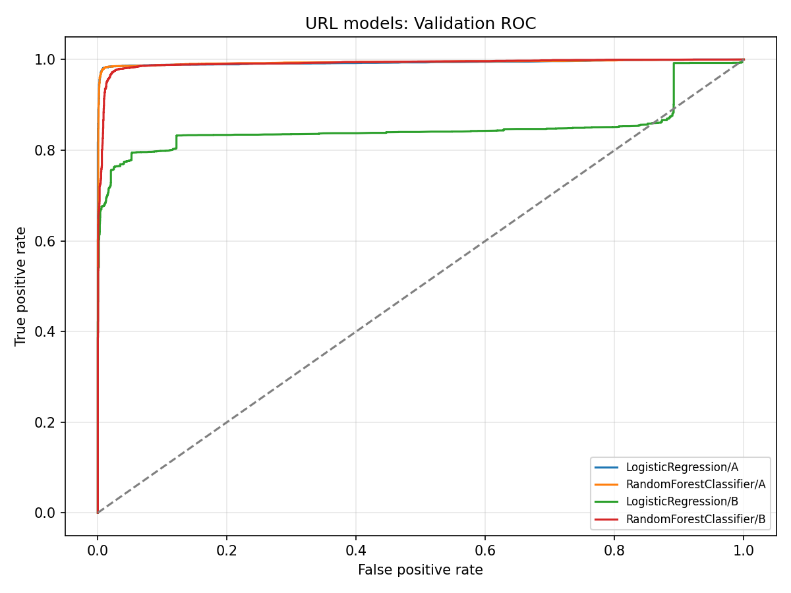
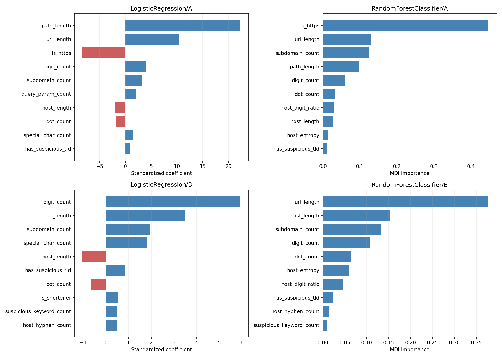

# Задание №11 — URL-модель

## Методика

Использован неизменённый Parquet задания №10: 50000 URL, Train 32869, Validation 8471, Test 8660. label: 0=safe, 1=phishing. В X передаются только признаки из extract_url_features(); source_id, URL, group, split и label исключены. Данные и индексы не пересоздаются. SHA-256 защищённых файлов записаны в metadata.

Два алгоритма: LogisticRegression(StandardScaler → classifier) и RandomForestClassifier. A — 22 признака; B — 19, без is_https, path_length, query_param_count. GridSearchCV только на Train с groups=зарегистрированный домен. StratifiedGroupKFold(5, shuffle=True, random_state=42); каждый fold проверен на отсутствие пересечений доменов и наличие обоих классов. StandardScaler обучается внутри соответствующего fold. Детерминированные признаки задания №9 не требуют fit.

Оптимизация: F2 phishing=1. LR: C=[0.1,1,10], class_weight=balanced, max_iter=3000. RF: n_estimators=[100,200], max_depth=[10,None], min_samples_leaf=2, class_weight=balanced. C исследует три масштаба регуляризации; RF сравнивает размер леса и ограниченную/полную глубину, лист минимум 2 уменьшает запоминание. random_state=42, n_jobs=1. Других алгоритмов и новых зависимостей нет.

## Сравнение на Validation

Ниже метрики при t2 каждой модели, выбранном исключительно на Validation. PR-AUC = average_precision_score (AP без интерполяции). Матрицы: [[TN,FP],[FN,TP]]. Fit — refit лучшей конфигурации на Train; Search — весь GridSearchCV. Задержка — среднее 30 predict_proba одной строки числовых признаков, без извлечения признаков.

| Модель | Accuracy | Precision | Recall | F1 | F2 | ROC-AUC | AP | Fit, с | Search, с | URL, мс |
|---|---:|---:|---:|---:|---:|---:|---:|---:|---:|---:|
| LogisticRegression/A | 0.983709 | 0.982775 | 0.984188 | 0.983481 | 0.983905 | 0.993469 | 0.995590 | 0.122 | 14.334 | 1.604 |
| RandomForestClassifier/A | 0.983945 | 0.983014 | 0.984427 | 0.983720 | 0.984144 | 0.994165 | 0.995821 | 2.005 | 66.448 | 9.887 |
| LogisticRegression/B | 0.855389 | 0.868717 | 0.832295 | 0.850116 | 0.839333 | 0.849788 | 0.909464 | 0.154 | 14.670 | 3.103 |
| RandomForestClassifier/B | 0.972730 | 0.965525 | 0.979636 | 0.972529 | 0.976781 | 0.991660 | 0.992693 | 3.101 | 78.112 | 19.168 |

| Модель | Macro Precision | Macro Recall | Macro F1 | Confusion Matrix |
|---|---:|---:|---:|---|
| LogisticRegression/A | 0.983697 | 0.983716 | 0.983706 | [[4225, 72], [66, 4108]] |
| RandomForestClassifier/A | 0.983933 | 0.983952 | 0.983942 | [[4226, 71], [65, 4109]] |
| LogisticRegression/B | 0.856094 | 0.855058 | 0.855210 | [[3772, 525], [700, 3474]] |
| RandomForestClassifier/B | 0.972730 | 0.972829 | 0.972729 | [[4151, 146], [85, 4089]] |

| Модель | Параметры | CV F2 ± std | t1 | t2 |
|---|---|---|---:|---:|
| LogisticRegression/A | {'classifier__C': 10.0} | 0.972045 ± 0.002114 | 0.01108384079717941 | 0.35104721622691076 |
| RandomForestClassifier/A | {'classifier__max_depth': 10, 'classifier__n_estimators': 100} | 0.970546 ± 0.001599 | 0.06321828336412233 | 0.3173583761060298 |
| LogisticRegression/B | {'classifier__C': 1.0} | 0.705011 ± 0.034966 | 0.1280798455664115 | 0.29919859917030583 |
| RandomForestClassifier/B | {'classifier__max_depth': None, 'classifier__n_estimators': 100} | 0.941482 ± 0.008564 | 0.11280021343674816 | 0.3784664383715637 |

Для сопоставимости при фиксированном пороге 0.5:

| Модель | Precision | Recall | F1 | F2 |
|---|---:|---:|---:|---:|
| LogisticRegression/A | 0.991050 | 0.981552 | 0.986278 | 0.983437 |
| RandomForestClassifier/A | 0.989611 | 0.981313 | 0.985444 | 0.982961 |
| LogisticRegression/B | 0.936291 | 0.788692 | 0.856177 | 0.814368 |
| RandomForestClassifier/B | 0.979602 | 0.966459 | 0.972986 | 0.969059 |



## Влияние артефактов и важность

Все safe URL корпуса используют HTTPS и не имеют содержательного path/query. Удаление трёх прямых индикаторов не исключает косвенные артефакты через url_length, special_char_count, digit_count и другие признаки. Это учебная модель на историческом UCI-корпусе; её оценки не гарантируют безопасность и не являются проверкой сайтов. Вероятности не калибровались; границы зон — эмпирические результаты Validation.

Изменение B относительно A при выбранных порогах:

| Алгоритм | ΔPrecision | ΔRecall | ΔF2 | ΔROC-AUC |
|---|---:|---:|---:|---:|
| LogisticRegression | -0.114058 | -0.151893 | -0.144572 | -0.143681 |
| RandomForestClassifier | -0.017489 | -0.004792 | -0.007364 | -0.002505 |



LR: показаны подписанные коэффициенты после StandardScaler; коэффициент означает изменение log-odds phishing при росте признака на одно обучающее стандартное отклонение, при прочих равных. Положительный знак направлен к phishing, отрицательный — к safe. RF: MDI feature_importances_, чувствительная к числу возможных разбиений и корреляции признаков. Важность не доказывает причинность.

**LogisticRegression/A**: path_length=22.304863; url_length=10.435861; is_https=-8.320889; digit_count=4.012422; subdomain_count=3.121495; query_param_count=2.048785; host_length=-1.922538; dot_count=-1.728166; special_char_count=1.491687; has_suspicious_tld=0.965759.

Позиции возможных артефактов: is_https: 3, url_length: 2, path_length: 1, query_param_count: 6, special_char_count: 9.

**RandomForestClassifier/A**: is_https=0.447297; url_length=0.130822; subdomain_count=0.124563; path_length=0.097689; digit_count=0.059305; dot_count=0.032069; host_digit_ratio=0.029691; host_length=0.027549; host_entropy=0.013791; has_suspicious_tld=0.010002.

Позиции возможных артефактов: is_https: 1, url_length: 2, path_length: 4, query_param_count: 14, special_char_count: 12.

**LogisticRegression/B**: digit_count=5.930590; url_length=3.494375; subdomain_count=1.958779; special_char_count=1.833809; host_length=-1.028261; has_suspicious_tld=0.839226; dot_count=-0.653826; is_shortener=0.529702; suspicious_keyword_count=0.493785; host_hyphen_count=0.485183.

Позиции возможных артефактов: is_https: исключён, url_length: 2, path_length: исключён, query_param_count: исключён, special_char_count: 4.

**RandomForestClassifier/B**: url_length=0.377491; host_length=0.153709; subdomain_count=0.131926; digit_count=0.106636; dot_count=0.064833; host_entropy=0.059507; host_digit_ratio=0.046471; has_suspicious_tld=0.021864; host_hyphen_count=0.014546; suspicious_keyword_count=0.009788.

Позиции возможных артефактов: is_https: исключён, url_length: 1, path_length: исключён, query_param_count: исключён, special_char_count: 11.

У RF/A is_https даёт **44.73%** MDI-важности, url_length — **13.08%**, path_length — **9.77%**. Это выраженная зависимость от прямых и косвенных индикаторов формата сбора. После удаления трёх признаков в RF/B url_length даёт **37.75%** важности. Уменьшенный набор не устраняет проблему; длина и другие структурные признаки остаются прокси. LR/A также опирается прежде всего на путь, длину и HTTPS. Высокое качество на этом корпусе нельзя переносить на произвольные реальные ссылки без внешней проверки.

## Выбор и пороги

Выбрана **RandomForestClassifier/A**. Критерий — максимальный Validation F2 при Precision >=0.85, затем Recall, ROC-AUC, меньший std CV F2, меньше признаков и предпочтение простой LR при полном равенстве. Скорость и интерпретируемость оценены по таблицам; они не подменяют приоритет F2/Recall. Даже выбранная модель остаётся зависимой от особенностей корпуса. CV std характеризует различие доменных folds, а не доверительный интервал внешнего качества.

**t1=0.06321828336412233**, **t2=0.3173583761060298**. Правило: SAFE при P<t1; SUSPICIOUS при t1<=P<t2; DANGEROUS при P>=t2. t2 — максимум F2 среди уникальных оценок Validation с Precision>=0.85; при равенстве выбираются Recall, Precision, меньший порог. Нулевая граница t2 исключена для возможности t1<t2. Если допустимого t2 нет, конфигурация исключается; если нет ни одной, Test не оценивается.

t1 — граница с максимальным покрытием SAFE при эмпирической доле phishing внутри SAFE <=1%, строго ниже t2. Перебираются уникальные оценки с правилом P<t1. Это явно заданная политика низкорисковой зоны, не гарантия будущего риска. Если допустимой непустой зоны нет, t1=0 и SAFE пустая. SUSPICIOUS — оставшаяся неопределённая зона: её нельзя автоматически считать безопасной или обнаруженным phishing.

Зоны выбранной модели на Validation:

| Зона | Строк | Phishing | Доля phishing в зоне | Доля всех phishing |
|---|---:|---:|---:|---:|
| SAFE | 3388 | 33 | 0.00974025974025974 | 0.007906085289889795 |
| SUSPICIOUS | 903 | 32 | 0.035437430786267994 | 0.007666506947771922 |
| DANGEROUS | 4180 | 4109 | 0.9830143540669857 | 0.9844274077623383 |

## Единственная оценка Test

Алгоритм, признаки, параметры и оба порога зафиксированы до предсказания Test. После просмотра Test ничего не подбиралось. **Переобучение на Train+Validation не выполнялось**: сохранён тот же Pipeline, обученный на 32869 Train URL. Тестовые метрики относятся непосредственно к сохранённой модели версии 1.0.0.

| Метрика | Test | Требование | Выполнено |
|---|---:|---:|---|
| accuracy | 0.981293 | — | — |
| roc_auc | 0.993550 | 0.9 | да |
| pr_auc | 0.995207 | — | — |
| f2 | 0.980161 | — | — |
| precision | 0.983071 | 0.85 | да |
| recall | 0.979436 | 0.85 | да |
| f1 | 0.981250 | — | — |
| macro_precision | 0.981301 | — | — |
| macro_recall | 0.981292 | — | — |
| macro_f1 | 0.981293 | — | — |

Confusion Matrix Test: `[[4259, 73], [89, 4239]]`.

Все три формальных требования URL-классификатора на этом Test выполнены. Это не устраняет ограничения разметки и артефактов.

## 20 дополнительных примеров после Test

Предполагаемые safe адреса известны по названиям организаций, но не проверялись по сети. Остальные примеры искусственные на зарезервированных доменах. Это демонстрация, не внешний размеченный benchmark. Ни параметры, ни пороги после этих примеров не менялись. SAFE не означает гарантированную безопасность.

| URL как текст | P_url | Категория | Комментарий |
|---|---:|---|---|
| `https://www.wikipedia.org/` | 0.058991 | SAFE | Предполагаемо безопасный: известная организация, корень сайта |
| `https://www.python.org/downloads/` | 0.781909 | DANGEROUS | Предполагаемо безопасный: страница загрузок Python |
| `https://www.gov.uk/browse/tax` | 0.791156 | DANGEROUS | Предполагаемо безопасный: раздел государственного сайта |
| `https://www.who.int/news` | 0.763157 | DANGEROUS | Предполагаемо безопасный: раздел новостей ВОЗ |
| `https://www.un.org/en/` | 0.765600 | DANGEROUS | Предполагаемо безопасный: раздел сайта ООН |
| `https://www.nasa.gov/missions/` | 0.772140 | DANGEROUS | Предполагаемо безопасный: раздел NASA |
| `https://www.microsoft.com/en-us/` | 0.791484 | DANGEROUS | Предполагаемо безопасный: раздел Microsoft |
| `https://www.google.com/search?q=python` | 0.962763 | DANGEROUS | Предполагаемо безопасный: поисковый запрос, не проверялся |
| `https://github.com/python/cpython` | 0.802439 | DANGEROUS | Предполагаемо безопасный: путь репозитория Python |
| `https://kaspi.kz/` | 0.150433 | SUSPICIOUS | Предполагаемо безопасный: известный домен банка/сервиса |
| `http://verify.example.com/login?password=123` | 1.000000 | DANGEROUS | Искусственный: HTTP, verify/login/password |
| `https://account-update.example.org/confirm` | 0.995309 | DANGEROUS | Искусственный: слова account/update/confirm |
| `http://secure-bank.example.test:8080/login` | 1.000000 | DANGEROUS | Искусственный: HTTP и нестандартный порт |
| `https://example.com@verify.example.test/password` | 0.994167 | DANGEROUS | Искусственный: userinfo маскирует фактический host |
| `https://free-prize.example.org/bonus?claim=1` | 0.998726 | DANGEROUS | Искусственный: обещание приза и бонуса |
| `http://a.b.c.example.test/verify//account` | 0.996561 | DANGEROUS | Искусственный: поддомены и двойной слеш |
| `https://kaspi-login.example.com/update?card=123456` | 0.999926 | DANGEROUS | Искусственный: название сервиса в поддомене |
| `https://halyk-verify.example.org/confirm?code=1234` | 0.999926 | DANGEROUS | Искусственный: название банка и запрос кода |
| `http://login-987654.example.test/reset?password=1` | 1.000000 | DANGEROUS | Искусственный: цифры, HTTP, password |
| `https://reward.example.test/free/bonus?account=1&verify=1` | 1.000000 | DANGEROUS | Искусственный: несколько ключевых слов |

Среди 10 предполагаемо безопасных примеров: SAFE — 1, SUSPICIOUS — 1, DANGEROUS — 8. Срабатывания на обычных разделах известных сайтов согласуются с зависимостью от path/query в исходном корпусе. Примеры демонстрируют ограничение переноса; они не являются проверенной внешней разметкой. Модель не следует считать готовой к надёжной оценке произвольных реальных ссылок. После этих наблюдений параметры, признаки и пороги не изменялись.


## Артефакты и воспроизведение

Сохранены ml/artifacts/url_model.joblib и url_model_meta.json. JSON содержит версию, UTC дату, параметры, порядок X, t1/t2, CV, сравнение, Test, SHA-256 датасета/индексов и ограничения. Модель и JSON остаются локальными по существующему .gitignore. Точное совпадение вероятностей до/после сериализации проверено на Validation. Новые URL нормализуются как в задании №10 (www и корневой слеш), затем обрабатываются единственной существующей extract_url_features(). Сеть не используется.

Измеренная задержка полного predict_url с извлечением признаков: **20.027 мс** (среднее 30 повторов одного URL, модель уже загружена; зависит от машины).

```powershell
python -m ml.url_model
python -m pytest -q -p no:cacheprovider --basetemp=.\.pytest_task11_temp
```

Каждый запуск обучения — новое воспроизведение всего эксперимента с одной финальной оценкой Test. Для просмотра результатов повторное обучение не требуется: читайте JSON и отчёт.

```python
from ml.url_model import predict_url
print(predict_url('https://www.python.org/downloads/'))
```

## Проверки

Новые модульные тесты: **29 passed** на малых синтетических данных. Полный запуск: **147 passed in 21.83s**, включая все **118 предыдущих** проверок. Проверены числовой X без метаданных, групповые folds, обучение StandardScaler внутри fold, воспроизводимость LR/RF, максимум F2 с ограничением Precision, границы зон, сериализация модели/JSON, новые URL без сети и неизменность защищённых файлов. Модульные тесты не переобучают модели на 50000 URL. Реальные вероятности до/после joblib совпали точно на Validation, оба графика проверены визуально.

SMS-компоненты, датасет URL, разбиение и код заданий №9–10 не изменены; SHA-256 защищённых файлов проверены. API, интерфейсы и задание №12 не реализованы. Git-коммит и push не выполнялись.
