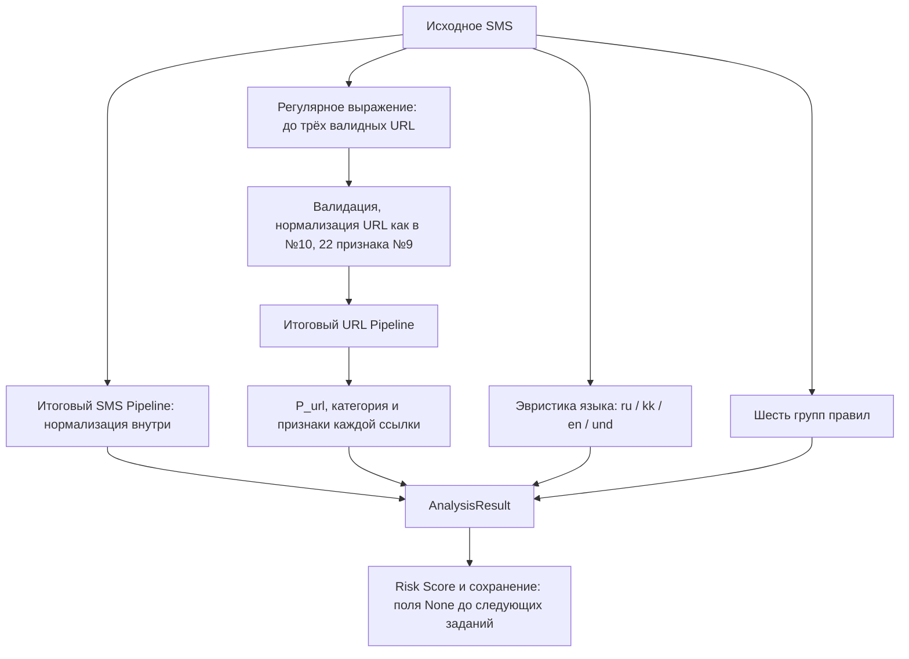

# Задание №12 — совместный анализ SMS и URL

## Цель и границы

Создан локальный сервис, который объединяет вероятности итоговых моделей №8 и №11, анализ не более трёх URL и шесть групп социальной инженерии. Сайты не открываются; HTTP, DNS, внешние API, обучение, изменение артефактов и запись проверок в БД отсутствуют. Задания №13 (Risk Score) и №14 (REST API) не реализуются.

Созданы `ml/predictor.py`, `ml/rules.py`, `apps/analysis/services.py`, `tests/test_analysis_services.py` и этот отчёт. Существующие обученные модели, метаданные, датасеты, ручные признаки SMS и код предыдущих заданий не изменены. Новых зависимостей нет. Git-коммит и push не выполнялись.

## Поток обработки



`analyze_sms(text)` проверяет непустой строковый ввод, находит URL, определяет язык, передаёт **исходный текст** модели SMS и отдельно ищет правила. Для ссылок вызывает `analyze_url()`. Возвращает `AnalysisResult`; `p_url_max` равен максимуму вероятностей реально проанализированных ссылок, либо `None` при пустом списке.

Ошибки отдельных URL не прерывают анализ SMS: невалидные кандидаты пропускаются. Невозможность загрузить модель или получить корректную вероятность — ошибка всего сервиса, а не фиктивная нулевая оценка.

## ModelPredictor и кеш

`get_predictor()` кеширует экземпляр сервиса. Дополнительно все обычные экземпляры `ModelPredictor` разделяют один bundle моделей/метаданных на процесс, защищённый `threading.Lock`. Это предотвращает повторную загрузку при одновременном первом обращении. При первом использовании обе модели загружаются через joblib, JSON читаются вместе с ними. Последующие вызовы повторно используют те же объекты; отдельный процесс имеет свой кеш.

Используются строго:

- `ml/artifacts/sms_model.joblib` и `sms_model_meta.json` — итоговый MultinomialNB №8, версия `1.0.0`;
- `ml/artifacts/url_model.joblib` и `url_model_meta.json` — итоговый RF/A №11, версия `1.0.0`.

`sms_baseline.joblib` не используется. Вероятность выбирается по позиции класса **1** в `classes_`, а не по предположению о номере колонки. Пороги читаются из JSON:

- SMS: `label = int(P_sms >= threshold)`, текущее значение `threshold=0.07675798320542866`;
- URL: `SAFE`, если `P_url<t1`; `SUSPICIOUS`, если `t1<=P_url<t2`; `DANGEROUS`, если `P_url>=t2`;
- текущие URL-пороги: `t1=0.06321828336412233`, `t2=0.3173583761060298`.

Эти значения приведены для паспорта текущих файлов, в реализации не зашиты. Проверяются допустимость порогов, версии, наличие класса 1, список признаков и его соответствие URL-модели. Повреждённые/отсутствующие файлы дают понятный `RuntimeError` с названиями ожидаемых артефактов без раскрытия содержимого. Ошибка загрузки кешируется; после исправления файлов нужен перезапуск процесса. Перезагрузка моделей «на лету» не реализуется.

Лог содержит только факт загрузки и версии либо общее сообщение об ошибке. Исходные SMS, URL, пароли, коды и внутреннее содержимое исключений туда не выводятся. Структура результата содержит сами найденные URL по требованиям задания, поэтому вызывающий код не должен автоматически журналировать весь `to_dict()`.

Для тестов конструктор принимает `sms_model`, `url_model`, `sms_meta`, `url_meta`. Если переданы все четыре объекта, joblib и чтение файлов не вызываются; тестовые объекты не подменяют общий кеш реальных моделей.

## URL и признаки

Извлекатель на регулярном выражении поддерживает HTTP/HTTPS, `www`, домены без схемы (`bit.ly/abc123`), Unicode/IDNA и query. Email распознаётся отдельной альтернативой и не превращается в URL. Для адресов без схемы проверяется известный публичный суффикс по встроенному PSL tldextract; сетевое обновление и кеш на диске отключены. Для тестов добавлена зарезервированная зона `.test`. Это уменьшает ложные совпадения на `file.txt` и обычном тексте. Явные HTTP/HTTPS URL проверяются валидатором независимо от наличия суффикса в PSL.

Сохраняются порядок появления и первые **три валидные** ссылки. Повторяющиеся ссылки не объединяются. Невалидный кандидат не расходует лимит. Терминальные знаки предложения и кавычки убираются эвристически; закрывающие скобки убираются только при отсутствии соответствующей открывающей. Сбалансированные скобки в query и скобки IPv6 сохраняются. Неоднозначные случаи, когда завершающий `!` или `?` является данными URL, могут требовать уточнения на следующем этапе: строковая эвристика не знает авторское намерение.

`analyze_url(url) -> URLAnalysis`:

1. Проверяет исходную строку через существующую `validate_url()`.
2. Применяет `normalize_url(..., strip_www=...)` согласно JSON модели: как при подготовке №10, без изменения регистра path/query и без удаления www из зарегистрированного домена.
3. Вызывает единственную существующую `extract_url_features()`; получает все 22 признака.
4. Создаёт числовую строку строго по `url_model_meta.json['feature_names']` и передаёт её кешированной модели.
5. Возвращает исходный URL, `p_url`, категорию, 22 признака, объяснения и предупреждение.

`URLAnalysis.to_dict()` доступен и для отдельной ссылки. Признаки относятся к нормализованному представлению для модели, а поле `url` сохраняет исходную принятую ссылку. Значения длины могут отличаться от исходной строки из-за канонизации №10.

SMS не нормализуется в сервисе до вызова Pipeline и не обрабатывается второй раз. Внутренняя нормализация прежней модели заменяет распознанные её собственными шаблонами URL на `<url>`. Реальный тест проверяет единственный вызов нормализатора и замену HTTP-ссылки токеном. Извлекатель сервиса шире старого нормализатора SMS: например, голый `bit.ly/abc123` или некоторые кириллические домены могут быть выделены для URL-модели, но не заменены `<url>` внутри старого SMS Pipeline. Обучение и его нормализация сохранены без изменений; дополнительная предварительная замена не делается, чтобы не менять ручные признаки и не нарушать совместимость.

## Правила социальной инженерии

`ml/rules.py` хранит словарь `RULES[group][language]`: **180 выражений**, шесть групп × три языка × десять выражений. Это отдельные правила сервиса, не замена ручных признаков `ml/features.py`.

| Группа | Смысл | Пример ru | Пример kk | Пример en |
|---|---|---|---|---|
| URGENCY | Срочность | срочно | шұғыл | urgent |
| MONEY_TRANSFER | Деньги/переводы | переведите деньги | ақша аударыңыз | transfer money |
| BANK_CARD | Карта и реквизиты | номер карты | карта нөмірі | card number |
| ACCOUNT_BLOCK | Блокировка | аккаунт заблокирован | аккаунт бұғатталды | account blocked |
| PRIZE | Призы/выигрыши | вы выиграли | сіз ұттыңыз | you won |
| CODE_REQUEST | Коды/пароли | пришлите код | кодты жіберіңіз | send the code |

`find_social_engineering_groups(text)` возвращает уникальные имена групп в порядке словаря. Регулярные выражения работают без учёта регистра, с границами Unicode-слов и поддержкой пробелов/переносов внутри фраз. Совпадение `urgent` внутри `urgently` не считается срабатыванием. Отрицания, контекст, морфология, транслитерация и намеренная обфускация не анализируются; совпадение само по себе не означает социальную инженерию.

## AnalysisResult

Результат — dataclass. `to_dict()` через `dataclasses.asdict()` рекурсивно преобразует вложенные ссылки и создаёт независимую структуру, готовую к JSON-сериализации.

| Поле | Содержание на этапе №12 |
|---|---|
| `id` | `None`, проверка ещё не сохраняется |
| `type` | `sms` |
| `language` | `ru`, `kk`, `en` или `und` |
| `category` | `None`, общая категория SMS относится к №13 |
| `risk_level` | `None` |
| `risk_score` | `None` |
| `p_sms` | Вероятность класса spam=1 |
| `p_url_max` | Максимальная вероятность URL либо `None` |
| `urls` | Список `URLAnalysis`: url, p_url, category, features, explanation, disclaimer |
| `features` | `sms_label` по реальному порогу и `social_engineering_groups` |
| `explanation` | Найденные группы и предупреждения об ограничениях |
| `recommendation` | `None`, относится к №13 |
| `disclaimer` | Предупреждение о вероятностном характере результата |
| `model_versions` | Версии SMS и URL из JSON |
| `created_at` | `None`, время сохранения не имитируется |

`features.sms_label=1` означает модельный spam по выбранному ранее порогу, а не итоговую категорию мошенничества. Даже при высоких `p_sms` и `p_url_max` поля №13 остаются `None`.

## Примеры с реальными сохранёнными моделями

Из корня проекта в активированном окружении:

```python
import json
from apps.analysis.services import analyze_sms, analyze_url

print(json.dumps(analyze_sms(
    "Please bring the blue notebook tomorrow."
).to_dict(), ensure_ascii=False, indent=2))

print(json.dumps(analyze_sms(
    "URGENT! Send the code: https://verify.example.com/login?password=123"
).to_dict(), ensure_ascii=False, indent=2))

print(json.dumps(analyze_url(
    "https://www.python.org/downloads/"
).to_dict(), ensure_ascii=False, indent=2))
```

Фактические результаты (округлены, признаки и длинные предупреждения в таблице опущены):

| Пример | p_sms | Ссылок | p_url_max / p_url | Результат |
|---|---:|---:|---:|---|
| SMS без URL: `Please bring the blue notebook tomorrow.` | 0.010362 | 0 | `None` | sms_label=0, правил нет |
| SMS с URL: `URGENT! Send the code: https://verify.example.com/login?password=123` | 0.999815 | 1 | 0.999926 | URL: DANGEROUS, группы URGENCY и CODE_REQUEST |
| Отдельно `https://www.python.org/downloads/` | — | 1 | 0.781909 | URL: DANGEROUS; наглядное ограничение модели, а не доказательство опасности сайта |

Фрагмент первого полного `AnalysisResult`:

```json
{
  "id": null,
  "type": "sms",
  "language": "en",
  "category": null,
  "risk_level": null,
  "risk_score": null,
  "p_sms": 0.010361574351409815,
  "p_url_max": null,
  "urls": [],
  "features": {"sms_label": 0, "social_engineering_groups": []},
  "explanation": [],
  "recommendation": null,
  "disclaimer": "Оценка носит вероятностный характер и не гарантирует безопасность или отсутствие мошенничества. SMS-модель оценивает spam, а не доказанный факт мошенничества.",
  "model_versions": {"sms": "1.0.0", "url": "1.0.0"},
  "created_at": null
}
```

Ни один URL примеров не открывается.

## Языки и ограничения моделей

Определение языка детерминированное: наличие казахских букв `ә ғ қ ң ө ұ ү һ і` → kk, иначе кириллица → ru, иначе латиница → en, иначе und. Это простая эвристика для учебного проекта. Казахский текст без характерных букв, смешанный текст и текст, состоящий преимущественно из ссылок, могут быть определены неточно. Отдельной ML-модели языка нет.

Для ru/kk всегда добавляется предупреждение о сниженной надёжности SMS-оценки: модель №8 обучена на английском UCI, её отдельные результаты ru/kk были низкими. Число p_sms не корректируется искусственно. Для und даётся предупреждение об определении языка. Правила всех трёх языков ищутся независимо от выбранного языка сообщения.

При наличии проанализированных URL добавляется предупреждение об артефактах модели №11: все safe строки обучающего корпуса имели HTTPS и не содержали содержательного path/query. Обычная страница известной организации может получить DANGEROUS, как в примере Python. Значения вероятностей не калибровались для реальной распространённости мошенничества. Сервис объединяет наблюдения, а не исправляет обученные модели и не гарантирует обнаружение угроз.

## Проверки

```powershell
python -m pytest tests/test_analysis_services.py -v -p no:cacheprovider --basetemp=.\.pytest_task12_temp
python -m pytest -q -p no:cacheprovider --basetemp=.\.pytest_task12_temp
```

На Windows / Python 3.12.14:

- Новые проверки: **39 passed in 3.72s**.
- Весь проект: **186 passed in 22.13s**, включая все **147 предыдущих** тестов.
- Проверены SMS без URL, с одной/тремя/четырьмя ссылками, лимит и порядок, кириллица, схемы и query, email/обычный текст, пунктуация, невалидные кандидаты, P_url_max и пустой список.
- Проверены все 180 выражений, границы слов, фразы, уникальность групп, ru/kk предупреждения и поля №13 со значением None.
- Фиктивные модели с обратным порядком classes_ проверяют именно колонку класса 1, пороги JSON и порядок признаков. Проверены сериализация dataclass, числовые вероятности и понятные ошибки.
- Параллельный тест восьми экземпляров подтверждает ровно одну joblib-загрузку каждой итоговой модели, без baseline, и отсутствие текста SMS в логах. Ошибки загрузки не приводят к повторным попыткам.
- Сетевые функции HTTP/DNS/TCP заблокированы в тесте анализа. Подмена моделей не читает joblib.
- Одна небольшая проверка реальных моделей подтверждает работу без переобучения, версии, единственную нормализацию SMS, токен `<url>` для HTTP-ссылки и неизменность файлов моделей/JSON.

Ошибок тестирования не обнаружено. Сохранённые модели и метаданные не перезаписывались.
