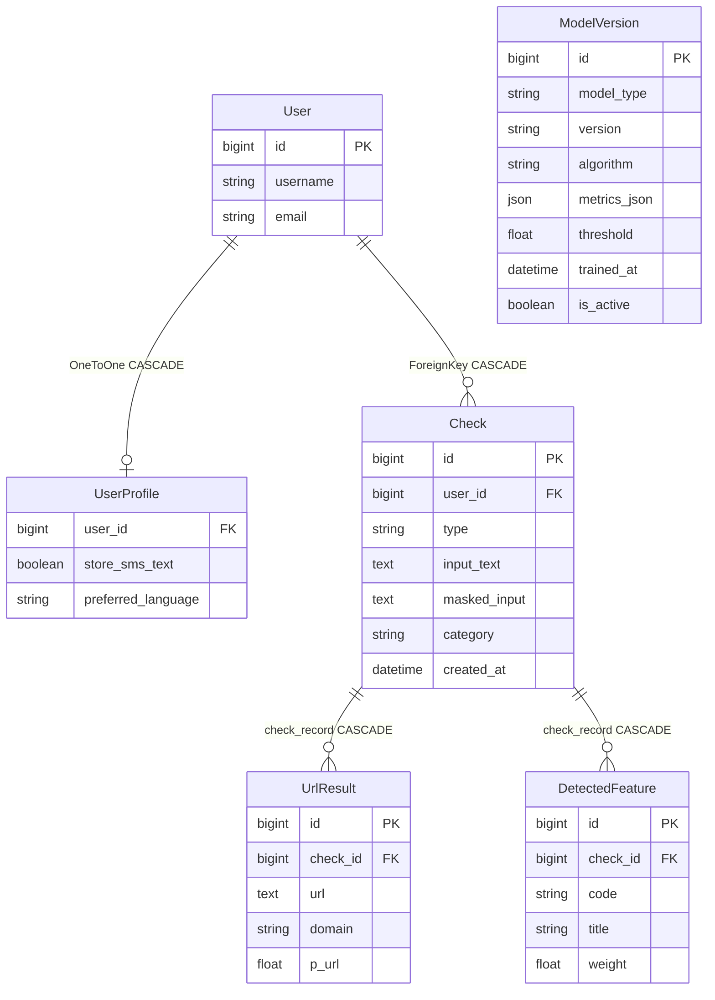

# Задание №16. База данных и история проверок

## Цель и модели

Сохранение рассчитанных результатов анализа, личная история и настройки приватности поверх существующего Django API. Новые зависимости не требуются.

| Модель | Назначение |
| --- | --- |
| UserProfile | OneToOne со стандартным User, согласие `store_sms_text=False`, предпочтение ru/kk/en |
| Check | Прежняя таблица и первичные ключи, nullable исходный SMS, язык, объяснения, рекомендации и версии моделей |
| UrlResult | Дочерний результат URL, безопасное представление адреса, домен, вероятность, категория, JSON признаков |
| DetectedFeature | Код и название сработавшей группы социальной инженерии, nullable вес |
| ModelVersion | Справочник версий и алгоритмов из существующих файлов метаданных, метрики, порог, дата обучения, активность |

`Check.check_type` и `Check.input_masked` реализованы как читаемые и записываемые алиасы существующих ORM-полей `type` и `masked_input`. Это сохраняет совместимость прежних запросов и API без дублирования значений. `check_type` возвращает SMS/URL, API сохраняет sms/url. Для ORM-фильтров используются `type` и `masked_input`.

В дочерних моделях внешний ключ называется `check_record`, SQL-колонка называется `check_id`. Имя `check` конфликтует со служебным методом проверки Django Model. Обратные связи `check.url_results` и `check.detected_features`. Отдельный nullable уникальный `demo_key` обеспечивает повторный запуск демонстрационного заполнения без дубликатов.

Вес группы отсутствует в существующем AnalysisResult как индивидуальный вклад. Поэтому `weight=NULL`, без выдумывания весов или изменения Risk Score. Неизвестные старые значения также остаются NULL. Версии в Check являются строковым снимком результата, а не внешними ключами на изменяемый справочник.



ModelVersion — независимый справочник. Уникальна пара model_type/version. Команда `sync_model_versions` читает JSON метаданных без загрузки или обучения моделей. Для SMS берётся `threshold`, для URL — существующий `t2`, граница опасного URL. Второй URL-порог `t1` остаётся в исходных метаданных. Метрики переносятся из `test_metrics` без повторной оценки Test.

## Миграции и сохранность

Добавлены accounts/0002_initial, analysis/0002_detectedfeature_modelversion_urlresult_and_more и analysis/0003_existing_history. Прежние миграции не изменены. Новые поля nullable, данные существующих полей сохраняются. Индексы Check по (user, created_at) и category.

Миграция данных создаёт профили существующих пользователей и переносит доступные значения прежнего result_json в структурированные поля и дочерние таблицы. Старые полностью замаскированные адреса сохраняются как имелись, домен не восстанавливается. Исходные SMS не восстанавливаются. Обратная операция переноса оставляет исходный JSON, обратная схема удалит новые таблицы и поля, поэтому откат схемы может потерять новые данные.

Перед применением сохранена резервная копия рабочей SQLite вне репозитория. После применения сравниваются все прежние колонки auth_user и analysis_check, включая ID и даты. Проверяется PRAGMA integrity_check. Полная миграция с нуля выполняется на отдельной временной базе, рабочая база не удаляется.

## Атомарность и приватность

`save_check` в apps/analysis/persistence.py работает внутри transaction.atomic. Check, UrlResult, DetectedFeature и окончательный JSON с ID/датой сохраняются вместе. Любое исключение откатывает всю запись. Функция получает готовый результат, повторного анализа не выполняет. Прежний импорт из apps.analysis.views сохранён для совместимости.

Без согласия `input_text=NULL`. В input_masked/старом masked_input остаются безопасные части сообщения. Телефоны, карты из 13–19 цифр с пробелами/дефисами и суммы с обозначением валюты заменяются на `***`. URL целиком заменяется на `***`, поскольку путь и query могут содержать коды или пароли. В UrlResult сохраняется только домен без userinfo, пути и query. Примеры используют вымышленные значения.

| Ввод | Сохранённое представление |
| --- | --- |
| Позвоните +7 (700) 123-45-67 сегодня | Позвоните *** сегодня |
| Карта 1234 5678 9012 3456 | Карта *** |
| Переведите 5000 тг | Переведите *** |
| Откройте https://demo.example/?code=123456 | Откройте *** |

Тот же фильтр применяется к строковым значениям JSON и признакам дочерних URL, а исходный ввод и адреса, повторённые в объяснениях, заменяются целиком. В result_json полный исходный SMS не копируется даже с согласием. Публичные категории, язык и снимок версий сохраняются как структурированные значения.

С согласия полный SMS хранится только в input_text и доступен владельцу через детализацию. Согласие действует на новые SMS. Выключение не удаляет ранее сохранённые полные тексты, удаление истории доступно отдельно. Для URL полный исходный ввод не сохраняется. API немедленного анализа по-прежнему возвращает вычисленный результат, API сохранённой истории возвращает маскированные данные и, при наличии согласованного текста, дополнительный input_text. Существующие ключи API и коды ответа сохранены.

Маскирование является ограниченным набором регулярных выражений, а не универсальным распознаванием персональных данных. Безопасный текст без совпадений может остаться неизменным в маскированном представлении. ФИО и произвольные секреты в свободном тексте автоматически не распознаются. Изначальный тест API для SQL/XSS адаптирован к частичному маскированию задания №16, проверки отсутствия raw-поля, утечки в JSON/логи и сохранности пользователей сохранены. HTML выводится с Django autoescape, JavaScript использует textContent.

## История и профиль

`GET /history/` доступен после входа. Только свои проверки, сортировка по убыванию created_at/id, 20 строк на страницу. Отображаются дата, тип, фрагмент до 60 символов, категория, уровень, Risk Score и действия. Все пять фильтров date_from/date_to/type/category/risk_level комбинируются и сохраняются в GET-параметрах пагинации. Для неверного диапазона дат возвращается HTTP 400 с сообщением. Пустая история содержит ссылку на проверку SMS.

Прежняя `/checks/<id>/` получает сохранённый результат через существующий API без ML. Показывает полный SMS, только если он был сохранён с согласием, иначе маскированный ввод. Чужие записи возвращают 404, включая доступ сотрудника.

`/profile/` показывает username/email, язык и согласие. Язык пока сохраняется как предпочтение, перевод интерфейса не добавлен. PasswordChangeForm проверяет старый пароль, совпадение новых и стандартные валидаторы Django. После сохранения update_session_auth_hash сохраняет текущую сессию. Пароль и хеш не выводятся.

Удаление одной записи — POST `/checks/<id>/delete/` с отдельным флажком подтверждения и CSRF, затем возврат в историю. Существующий DELETE API сохранён. Удаление всей истории — отдельная форма POST профиля с подтверждением, транзакцией и фильтром владельца. Дочерние результаты удаляются каскадно. Через GET удалений нет. Сообщение подтверждает завершение операции. Ограничение API 30 проверок в минуту и сессионный CSRF сохранены.

## Запуск и демонстрация

Из корня существующего проекта в активированном виртуальном окружении выполнить команды.

```powershell
python manage.py migrate
python manage.py sync_model_versions
python manage.py check
python manage.py makemigrations --check --dry-run
python -m pytest -q -p no:cacheprovider --basetemp=.\.pytest_task16_temp
python manage.py runserver
```

Для демонстрационного пользователя задайте собственный пароль через переменную окружения без сохранения в репозитории. В PowerShell можно запросить его без отображения на экране.

```powershell
$demoSecret = Read-Host 'Пароль демонстрационного пользователя' -AsSecureString
$env:SMS_GUARD_DEMO_PASSWORD = [System.Net.NetworkCredential]::new('', $demoSecret).Password
python manage.py seed_demo
Remove-Item Env:SMS_GUARD_DEMO_PASSWORD
```

Поддерживается также `--password`, но значение аргумента может попасть в историю оболочки. Команда создаёт sms_guard_demo и 30 проверок за разные дни, по десять SAFE/SUSPICIOUS/FRAUDULENT, связанные URL и группы. Все примеры и показатели искусственные, вероятности NULL, реальные модели не вызываются. Проверки явно помечаются на странице и в JSON. Повторный запуск сохраняет существующие demo_key без дублирования и не меняет пароль. Если имя уже занято аккаунтом без демонстрационных записей, команда завершается без изменения аккаунта. В частности, после удаления всей демоистории повторный запуск потребует отдельного решения владельца аккаунта. Данные ML и выборки не затрагиваются.

## Проверки и ограничения

Полный прогон завершён 14.11.2026. Результат `374 passed in 246.57s`, включая 44 новых теста и 330 прежних с адаптацией одного теста маскирования. tests/test_history.py проверяет профиль и согласие, приватность, маски, связанные результаты, откат, владельца, фильтры, пагинацию, детали, удаление, пароль и сессию, CSRF, повтор seed_demo и метаданные.

| Проверка | Результат |
| --- | --- |
| manage.py check | Проблем нет, 0 silenced |
| makemigrations --check --dry-run | No changes detected |
| migrate на рабочей БД | Три новые миграции применены, повторный запуск без изменений |
| Миграция отдельной пустой БД | Все миграции применены успешно |
| Миграция отдельной копии старой БД | Все прежние колонки пользователей и проверок сохранены |
| Рабочая SQLite | integrity_check = ok, все четыре прежние проверки и ID сохранены |
| Защищённые данные и ML | SHA-256 33 файлов совпадают с исходными |
| seed_demo дважды в отдельной БД | Ровно 30 проверок, 30 UrlResult, 20 DetectedFeature |
| HTTP-проверка страниц | История, вторая страница, фильтр, профиль и результат вернули 200 |
| JavaScript | node --check static/js/analysis.js выполнен успешно |
| Повтор API/UI/истории после последних правок | 136 passed in 221.87s |

Первый частичный прогон выявил только прежнее ожидание полного маскирования текста в тесте SQL/XSS. Ожидание приведено к заданию №16, последующий полный прогон успешен. Дополнительно вручную проверены маски сокращённых URL без протокола и сохранение версии URL-модели. Визуальная проверка страниц в настоящем браузере не проводилась, HTTP-ответы, шаблоны и безопасность проверены автоматизированно.

Демонстрационные записи создаются в тестовой базе во время тестов, рабочие пользовательские записи не заменяются. Полный перевод интерфейса, Dashboard и итоговый этап №18 в это задание не входят.

Автоматическая проверка разрешений отклонила команду удаления временных каталогов pytest, сообщив о необходимости недоступного sandbox approval. Административные команды не применялись. Папки `.pytest_task16_unit`, `.pytest_task16_temp` и `.pytest_task16_final_unit` могут оставаться локально и не предназначены для Git. Резервная копия SQLite и отдельные проверочные базы находятся вне репозитория в рабочем каталоге Codex `work/task16`.
