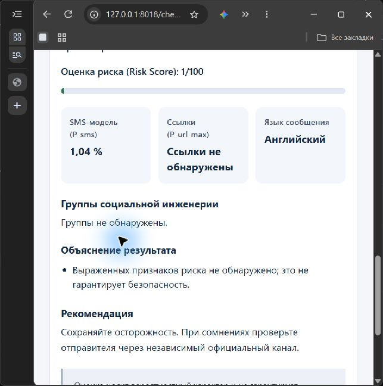
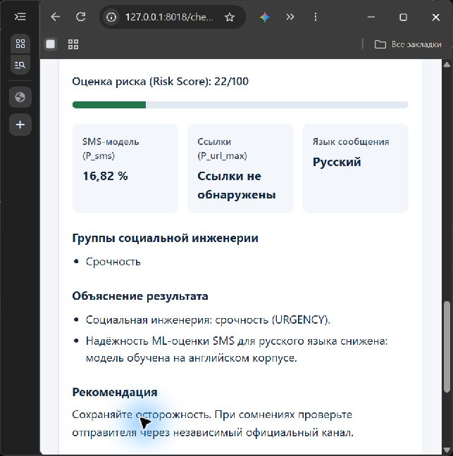
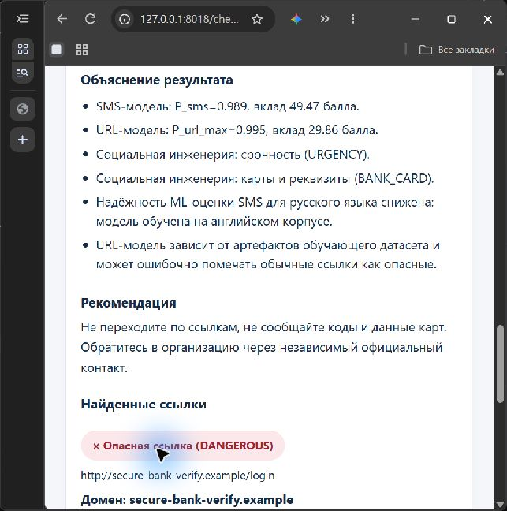
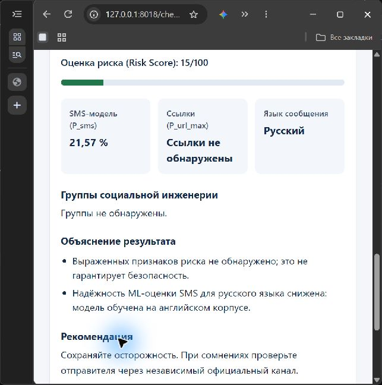

# Демонстрационные сценарии SMS Guard

## 13 образцов §8.3

Результаты вычислены текущими сохранёнными моделями с исходными порогами и YAML. Ожидания — гипотезы автора ТЗ. В образце №6 IP 192.0.2.15 заменён на account-update.example, в №8 bit.ly заменён на short.example, чтобы все демонстрационные URL соответствовали пользовательскому ограничению зарезервированных доменов. Эти два образца являются явно обозначенными адаптациями. Оригинальные IP и сокращатели отдельно проверены автотестами.

| № | Язык | Искусственный ввод | Ожидание ТЗ | Фактическая категория | Risk Score | Группы / признаки | Сопоставление |
|---|---|---|---|---|---|---|---|
| 1 | ru | Привет! Встречаемся завтра в 18:00 у входа в библиотеку. | SAFE | SUSPICIOUS | 55 | нет групп | РАСХОЖДЕНИЕ |
| 2 | en | Your order #4821 has been shipped and will arrive on Monday. | SAFE | SAFE | 10 | нет групп | совпало |
| 3 | kk | Сәлем! Ертең сағат 10:00-де кездесеміз бе? | SAFE | SUSPICIOUS | 56 | нет групп | РАСХОЖДЕНИЕ |
| 4 | ru | Ваш код подтверждения: 4821. Никому не сообщайте этот код. | SAFE/SUSPICIOUS | FRAUDULENT | 70 | CODE_REQUEST | РАСХОЖДЕНИЕ |
| 5 | ru | Ваша карта заблокирована! Срочно подтвердите данные по ссылке: http://secure-bank-verify.example/login | FRAUDULENT | FRAUDULENT | 93 | URGENCY, BANK_CARD | совпало |
| 6 | en | URGENT: Your account will be suspended in 24 hours. Verify now at http://account-update.example/account-update | FRAUDULENT | FRAUDULENT | 87 | URGENCY | совпало |
| 7 | ru | Мама, у меня проблемы, срочно переведи 50 000 на этот номер, потом всё объясню. Никому не говори. | FRAUDULENT | SAFE | 22 | URGENCY | РАСХОЖДЕНИЕ |
| 8 | en | Congratulations! You won a $1000 gift card. Claim your prize: http://short.example/prize-claim-test | FRAUDULENT | FRAUDULENT | 87 | PRIZE | совпало |
| 9 | ru | Сотрудник службы безопасности банка: назовите код из SMS для отмены подозрительной операции. | FRAUDULENT | SAFE | 15 | нет групп | РАСХОЖДЕНИЕ |
| 10 | kk | Картаңыз бұғатталды. Жедел түрде мына сілтеме арқылы растаңыз: http://bank-kz-verify.test | SUSPICIOUS/FRAUDULENT | FRAUDULENT | 85 | нет групп | совпало |
| 11 | ru | Ваша посылка ожидает оплаты таможенного сбора 350 ₸: http://post-delivery-pay.example | SUSPICIOUS/FRAUDULENT | FRAUDULENT | 85 | нет групп | совпало |
| 12 | URL | https://www.example.com/about | SAFE | DANGEROUS | — | is_https | РАСХОЖДЕНИЕ |
| 13 | URL | http://xn--exmple-cua.test/secure/login?verify=1 | DANGEROUS | DANGEROUS | — | has_punycode | совпало |

## Пять обязательных сценариев A–E

Используйте отдельную демонстрационную базу, согласие на сохранение SMS оставьте выключенным. Откройте приложение, войдите, выберите нужную страницу и введите текст вручную. Сервер читает реальные joblib; жёстко заданных ответов нет. Повторные проверки создают отдельные записи после завершения анализа, защита от двойного клика действует на выполняющуюся форму.

### Сценарий A

Ввод `Please bring the blue notebook tomorrow.`.

1. Открыть /check/sms/, вставить ввод и нажать кнопку проверки.
2. Показать индикатор загрузки, фактическую категорию, вероятность и объяснения. Для SMS со ссылкой раскрыть независимый URL-результат.
3. Зафиксированный результат реального HTTP-потока — SAFE, Risk Score 1.
4. Перейти в /history/, найти новую запись, нажать «Подробнее». Проверить дату, маску и сохранённый результат без повторного вызова ML.
5. Открыть Dashboard за 30 дней и показать увеличение общего количества и соответствующей категории.
6. При расхождении с ожидаемой угрозой объяснить ограничение, сохранить фактический результат. Предварительные ответы не подставлять.

### Сценарий B

Ввод `Мама, у меня проблемы, срочно переведи 50 000 на этот номер, потом всё объясню. Никому не говори.`.

1. Открыть /check/sms/, вставить ввод и нажать кнопку проверки.
2. Показать индикатор загрузки, фактическую категорию, вероятность и объяснения. Для SMS со ссылкой раскрыть независимый URL-результат.
3. Зафиксированный результат реального HTTP-потока — SAFE, Risk Score 22.
4. Перейти в /history/, найти новую запись, нажать «Подробнее». Проверить дату, маску и сохранённый результат без повторного вызова ML.
5. Открыть Dashboard за 30 дней и показать увеличение общего количества и соответствующей категории.
6. При расхождении с ожидаемой угрозой объяснить ограничение, сохранить фактический результат. Предварительные ответы не подставлять.

### Сценарий C

Ввод `Ваша карта заблокирована! Срочно подтвердите данные по ссылке: http://secure-bank-verify.example/login`.

1. Открыть /check/sms/, вставить ввод и нажать кнопку проверки.
2. Показать индикатор загрузки, фактическую категорию, вероятность и объяснения. Для SMS со ссылкой раскрыть независимый URL-результат.
3. Зафиксированный результат реального HTTP-потока — FRAUDULENT, Risk Score 93.
4. Перейти в /history/, найти новую запись, нажать «Подробнее». Проверить дату, маску и сохранённый результат без повторного вызова ML.
5. Открыть Dashboard за 30 дней и показать увеличение общего количества и соответствующей категории.
6. При расхождении с ожидаемой угрозой объяснить ограничение, сохранить фактический результат. Предварительные ответы не подставлять.

### Сценарий D

Ввод `https://www.example.com/about`.

1. Открыть /check/url/, вставить ввод и нажать кнопку проверки.
2. Показать индикатор загрузки, фактическую категорию, вероятность и объяснения. Для SMS со ссылкой раскрыть независимый URL-результат.
3. Зафиксированный результат реального HTTP-потока — DANGEROUS, Risk Score не рассчитывается.
4. Перейти в /history/, найти новую запись, нажать «Подробнее». Проверить дату, маску и сохранённый результат без повторного вызова ML.
5. Открыть Dashboard за 30 дней и показать увеличение общего количества и соответствующей категории.
6. При расхождении с ожидаемой угрозой объяснить ограничение, сохранить фактический результат. Предварительные ответы не подставлять.

### Сценарий E

Ввод `Сотрудник службы безопасности банка: назовите код из SMS для отмены подозрительной операции.`.

1. Открыть /check/sms/, вставить ввод и нажать кнопку проверки.
2. Показать индикатор загрузки, фактическую категорию, вероятность и объяснения. Для SMS со ссылкой раскрыть независимый URL-результат.
3. Зафиксированный результат реального HTTP-потока — SAFE, Risk Score 15.
4. Перейти в /history/, найти новую запись, нажать «Подробнее». Проверить дату, маску и сохранённый результат без повторного вызова ML.
5. Открыть Dashboard за 30 дней и показать увеличение общего количества и соответствующей категории.
6. При расхождении с ожидаемой угрозой объяснить ограничение, сохранить фактический результат. Предварительные ответы не подставлять.

Для B и E реальные модели пропускают угрозу, для D обычный example.com/about отмечен DANGEROUS. Сценарии демонстрируют ограничения, а не гарантированную точность. Реальные браузерные действия и проверка истории/Dashboard отражены в 18_environment_results.json. Полное воспроизведение HTTP-переходов всех пяти сценариев подтверждено отдельным автотестом.

## Сценарий резервной записи на 4 минуты 30 секунд

| Время | Экран и действия | Пример речи |
|---|---|---|
| 0:00–0:25 | Вход и Dashboard | «SMS Guard — учебный проект. Результаты вероятностные, корпуса ограничивают перенос качества». |
| 0:25–0:55 | A, безопасное английское SMS | «Ввод проходит через сохранённый Pipeline, показаны вероятность и причины». |
| 0:55–1:30 | B, перевод денег без ссылки | «Здесь модель пропускает угрозу. Русский язык не имеет подтверждённой поддержки». |
| 1:30–2:05 | C, SMS со ссылкой | «Ссылка извлечена автоматически и отдельно оценена URL-моделью». |
| 2:05–2:40 | D, отдельный URL | «Сайт не открывается. Обычный URL получает ложную тревогу из-за смещения корпуса». |
| 2:40–3:10 | E, запрос кода | «Фраза “назовите код из SMS” не покрыта текущим словарём. Это будущая работа». |
| 3:10–3:45 | История, подробный результат и Dashboard | «Проверки сохранены, тексты замаскированы, счётчики обновились». |
| 3:45–4:15 | Новый ввод от комиссии | «Текст отсутствует в сценариях, расчёт идёт в реальном времени». |
| 4:15–4:30 | Выводы | «URL-метрики на корпусе высокие, но SMS Precision/F1 и RU/KK не достигли ТЗ». |

Видеофайл не создан. Запишите экран и голос по этому плану, исключите реальные SMS и секреты из кадра. Для устного показа следуйте порядку §8.2, оставляя время на объяснение каждого несовпадения.

