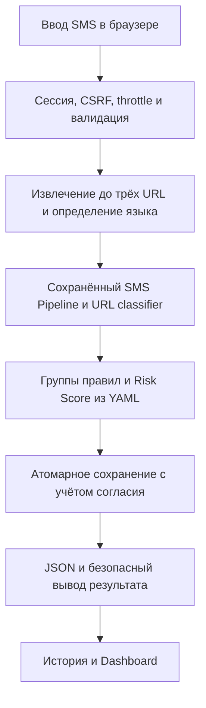
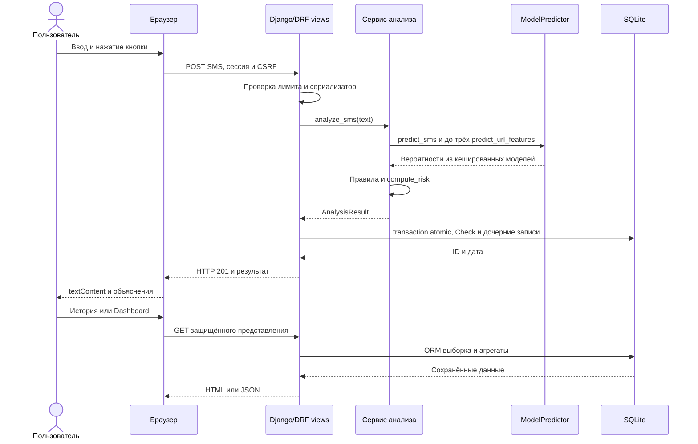

# Задание №18. Комплексное тестирование и демонстрация

## 1. Цель и объект

Проверен существующий SMS Guard, HEAD `44142be293cb52cfa4e3903d43514971afc1dc94`. До работы изменения заданий №1–17 были сохранены; прежние папки pytest задания №16 оставлены локально. Архитектура, модели, разбиения, Risk Score, правила и миграции не менялись. Новые возможности приложения не добавлялись.

## 2. Окружение

Python 3.12.14, Windows, Django 5.2.8, scikit-learn 1.6.1, SQLite. Версии зависимостей перечислены в requirements.txt. Исходная рабочая база сохранена отдельно. Тесты используют Django test DB и уникальные каталоги системного TEMP.

## 3. Трассировка и тест-кейсы

Подготовлено 66 автокейсов, 10 проверок качества/аудита и четыре ручных проверки NOT TESTED в [18_test_cases.md](18_test_cases.md). Все исходные коды ФТ/НФТ и не имеющие кодов разделы включены в [матрицу](18_traceability_matrix.md).

## 4. Полный pytest

PASSED 432, FAILED 0, ERROR 0, SKIPPED 0. [JUnit XML](18_pytest.xml). Сначала 401 прежний тест прошёл отдельно; затем добавлены содержательные проверки безопасности, надёжности, реальных HTTP-потоков и подготовительных модулей. Прежние ожидания не изменялись. Предупреждения Matplotlib/Pyparsing о deprecated API отражены в журнале pytest и не являются FAILED/ERROR.

## 5. Покрытие строк

| Модуль | Покрыто / всего | Точное покрытие |
|---|---|---|
| apps\analysis\services.py | 106 / 106 | 100.000000% |
| ml\__init__.py | 0 / 0 | 100.000000% |
| ml\baseline.py | 50 / 58 | 86.206897% |
| ml\calibrate_risk.py | 59 / 89 | 66.292135% |
| ml\compare_sms.py | 76 / 126 | 60.317460% |
| ml\features.py | 58 / 59 | 98.305085% |
| ml\predictor.py | 89 / 99 | 89.898990% |
| ml\preprocessing.py | 42 / 43 | 97.674419% |
| ml\risk.py | 125 / 143 | 87.412587% |
| ml\rules.py | 5 / 5 | 100.000000% |
| ml\url_dataset.py | 158 / 205 | 77.073171% |
| ml\url_features.py | 103 / 106 | 97.169811% |
| ml\url_model.py | 163 / 264 | 61.742424% |
| Итого ml/, включая risk | 928 / 1197 | 77.527151% |
| Итого с сервисами анализа | 1034 / 1303 | 79.355334% |

Отдельно SMS preprocessing — preprocessing.py, SMS classifier — baseline.py и compare_sms.py, URL classifier — url_model.py, URL features — url_features.py, общий predictor — predictor.py, rules/risk — одноимённые модули. Полный исходный [coverage JSON](18_coverage.json) содержит строки. В покрытие входят функции драйверов обучения, но повторные production fit/search/calibrate в этом задании не запускались. Существующие unit-тесты создают малые синтетические объекты в памяти; новые проверки CLI используют готовую модель или временные данные.

## 6. Безопасность

SQL Injection проверена точной строкой `' OR 1=1 --` в SMS и фильтрах истории, чужие записи не раскрыты. XSS с точным `` проверен экранированием истории, отсутствием текста в Dashboard и безопасными DOM-операциями. Браузерная проверка фактического XSS описана в environmental evidence. CSRF проверен Django Client(enforce_csrf_checks=True). Подмена ID не даёт просмотреть, удалить чужую запись или удалить чужую историю. Перебор ограничен после пяти неудач минимум на 60 с, подтверждён тестовыми часами.

HttpOnly/SameSite=Lax подтверждены, Secure проверен для HTTPS в тесте. Локальный HTTP использует Secure=False, что соответствует этому режиму. Это не проверка реально развёрнутого TLS. .env исключён из Git; реальные секреты в артефакты отчёта не копируются. DEBUG текущей рабочей dev-конфигурации отражён в матрице отдельно от чистого запуска DEBUG=False.

## 7. Надёжность

Проверены пустой/пробельный ввод, 1000/1001 символов, бинарный и невалидный UTF-8 JSON, неправильные схемы/hostname, отсутствие домена, IP/Punycode, SMS без/с несколькими URL. Потеря каждого файла модели и metadata и повреждённый JSON моделировались только на временных копиях. Health остаётся 200 с доступностью, анализ отдаёт 503, записей не остаётся. Рабочие файлы не переименовывались. Внешняя репутация URL не используется, поэтому её сбой неприменим; автономность собственного анализа подтверждена запретом сетевых вызовов в тесте.

Модели загружаются лениво один раз на процесс, после неуспешной загрузки для восстановления нужен перезапуск. Буквальное требование сообщения об отсутствующей модели при старте не выполнено, хотя безопасная деградация первого анализа подтверждена.

## 8. Производительность

| Проверка | Запросов | Среднее, мс | Максимум, мс | Результат |
|---|---|---|---|---|
| НФТ-1, реальное SMS с 3 URL, API и сохранение | 100 | 153.067192 | 253.501500 | PASS, предел 500 мс |
| НФТ-2, серверный api, 1000 строк | 10 | 40.996860 | 45.760500 | PASS серверной части |
| НФТ-2, серверный html, 1000 строк | 10 | 10.157970 | 12.151500 | PASS серверной части |
| НФТ-6, фиксированное тестовое время | 40 | 13.980498 | 34.043200 | 30 принятых, 10 ответов 429 |
| НФТ-3, реальный двойной клик, серверный лог | 2 клика / 1 запрос | 440.000000 | 440.000000 | Одна новая запись, N=1 |

Первый прогрев перед 100 запросами занял 399.042500 мс и показан отдельно. Модели реальные, внешних API нет. Чтобы не отключать throttle для серии, между запросами моделировалось 3 секунды на часах только CheckThrottle. Измерялись настоящие длительности каждого запроса через perf_counter, не виртуальное время. Ограничение 30/мин проверено отдельно по 40 запросам в одном интервале.

НФТ-3 проверен реальным двойным кликом Chrome, счётчик копии БД вырос с 4 до 5, результат A один. Сервер не предоставляет idempotency key для произвольных повторных HTTP-запросов после завершения формы. Среднее/максимум обработчика двойного клика в браузере не измерялись; наблюдались два клика и одна сохранённая запись. Полная загрузка Dashboard с сетью/CDN/canvas при 1000 строк NOT TESTED; серверный HTML-каркас не выдаётся за браузерное время.

## 9. Итоговые метрики моделей

Порог SMS и оба URL-порога неизменны. SMS Test содержит 771 строку из прежнего sms_split.json, URL Test — 8660 из url_split.json. Доменные группы пересчитаны из URL и не пересекаются, SHA-256 Parquet и split совпадают с metadata. Фактические URL Train/Validation/Test составляют 32869/8471/8660, то есть 65.738/16.942/17.320% вместо буквальных 70/15/15, как следствие группового разделения; баланс классов между частями также различается. Это отмечено отдельно от успешно подтверждённого отсутствия доменной утечки. Test уже оценивался в прежних заданиях, нынешний прогон — аудит того же Test, не новая независимая выборка. Подбора по нему не было.

Бинарная метка SMS равна 1 при p_sms ≥ 0.07675798320542866. Для URL бинарный phishing=1 означает p_url ≥ t2=0.3173583761060298; зона SUSPICIOUS между t1=0.06321828336412233 и t2 остаётся ниже этой бинарной границы.

| Метрика | Сохранённая SMS-модель | Сохранённая URL-модель |
|---|---|---|
| accuracy | 0.953307393 | 0.981293303 |
| precision | 0.743589744 | 0.983070501 |
| recall | 0.935483871 | 0.979436229 |
| f1 | 0.828571429 | 0.981250000 |
| macro_precision | 0.867207716 | 0.981300660 |
| macro_recall | 0.945618042 | 0.981292445 |
| macro_f1 | 0.900772201 | 0.981293203 |
| roc_auc | 0.978209154 | 0.993549727 |
| pr_auc | 0.950475253 | 0.995206901 |
| f2 | 0.889570552 | 0.980160932 |

SMS Confusion Matrix [[TN,FP],[FN,TP]] — `[[648, 30], [6, 87]]`.
URL Confusion Matrix — `[[4259, 73], [89, 4239]]`.

Прежняя SMS metadata содержит метрики train-only до refit — `[[646, 32], [7, 86]]`. Они не приписываются артефакту, обученному затем на 4364 Train+Validation. Текущая оценка выполнена для этого сохранённого артефакта, порог 0.07675798320542866. URL-модель сохранена Train-only, повторные метрики совпали с metadata.

SMS удовлетворяет Recall ≥0.90, но Precision/F1 ниже 0.90 — **FAIL**. URL удовлетворяет Precision/Recall ≥0.85 и ROC-AUC ≥0.90 — **PASS** на этом корпусе. PR-AUC рассчитан как average_precision_score (AP без интерполяции). SMS spam является прокси и не подтверждает мошенничество.

Время одного SMS predict_proba, 100 повторов после прогрева — среднее 5.893283, максимум 9.162400 мс. URL на одной строке готовых числовых признаков — среднее 14.640322, максимум 27.145800 мс. Извлечение URL-признаков в последнюю оценку не входит.

## 10. Русский и казахский языки

| Язык | SMS | Precision | Recall | F1 | CM | Recall совместной системы non-SAFE / FRAUDULENT |
|---|---|---|---|---|---|---|
| ru | 100 | 0.347222 | 0.500000 | 0.409836 | [[3, 47], [25, 25]] | 0.500000 / 0.440000 |
| kk | 50 | 0.342105 | 0.520000 | 0.412698 | [[0, 25], [12, 13]] | 0.400000 / 0.320000 |

Оба SMS Recall ниже 0.80, поддержка RU/KK не подтверждена. Набор искусственный, малый и вручную проверен ранее. Для SMS-классификатора он не обучающий, но в №13 использовался при подборе весов Risk, поэтому показатели совместного сервиса на нём являются development-оценкой. Английский корпус не покрывает русскую/казахскую лексику. Полные дополнительные метрики в 18_model_results.json.

## 11. Фактические ошибки моделей

Для каждой модели приведены первые пять FP и пять FN фиксированного Test. Тексты SMS взяты из публичного UCI, цифры заменены *, адреса скрыты. URL полностью обезличены зарезервированным hostname, сохранены исходный source_id, test_position и измеренные признаки для проверки на локальном корпусе. Причины ниже являются гипотезами, выводимыми из ограничений корпуса, и не доказанными причинными объяснениями.

| Модель / тип | ID источника | Язык | Безопасный фрагмент | Истина → прогноз | P(1) | Возможная причина | Будущая работа |
|---|---|---|---|---|---|---|---|
| SMS/FP | 2929 | en | Ok... U enjoy ur shows... | 0 → 1 | 0.140738583 | Смещение к spam при низком пороге, короткий разговорный текст | Расширить независимый корпус и заново валидировать порог/признаки |
| SMS/FP | 2385 | en | Your pussy is perfect! | 0 → 1 | 0.108365005 | Смещение к spam при низком пороге, короткий разговорный текст | Расширить независимый корпус и заново валидировать порог/признаки |
| SMS/FP | 1057 | en | I'm at work. Please call | 0 → 1 | 0.138672875 | Смещение к spam при низком пороге, короткий разговорный текст | Расширить независимый корпус и заново валидировать порог/признаки |
| SMS/FP | 1988 | en | S..antha num corrct dane | 0 → 1 | 0.268963195 | Смещение к spam при низком пороге, короткий разговорный текст | Расширить независимый корпус и заново валидировать порог/признаки |
| SMS/FP | 3850 | en | Can you plz tell me the ans. BSLVYL sent via [address omitted] | 0 → 1 | 0.103721535 | Смещение к spam при низком пороге, короткий разговорный текст | Расширить независимый корпус и заново валидировать порог/признаки |
| SMS/FN | 1639 | en | *A$NETWORKS allow companies to bill for SMS, so they are responsible for their "suppliers", just as a shop has to give a guarantee on what they sell. B. G. | 1 → 0 | 0.010849185 | Необычная лексика spam, близкая к обычной переписке | Расширить независимый корпус и заново валидировать порог/признаки |
| SMS/FN | 2775 | en | How come it takes so little time for a child who is afraid of the dark to become a teenager who wants to stay out all night? | 1 → 0 | 0.000599923 | Необычная лексика spam, близкая к обычной переписке | Расширить независимый корпус и заново валидировать порог/признаки |
| SMS/FN | 1431 | en | For sale - arsenal dartboard. Good condition but no doubles or trebles! | 1 → 0 | 0.013031393 | Необычная лексика spam, близкая к обычной переписке | Расширить независимый корпус и заново валидировать порог/признаки |
| SMS/FN | 4950 | en | Hi this is Amy, we will be sending you a free phone number in a couple of days, which will give you an access to all the adult parties... | 1 → 0 | 0.003141925 | Необычная лексика spam, близкая к обычной переписке | Расширить независимый корпус и заново валидировать порог/признаки |
| SMS/FN | 5373 | en | dating:i have had two of these. Only started after i sent a text to talk sport radio last week. Any connection do you think or coincidence? | 1 → 0 | 0.003375384 | Необычная лексика spam, близкая к обычной переписке | Расширить независимый корпус и заново валидировать порог/признаки |
| URL/FP | 3227 | — | https://redacted.example | 0 → 1 | 0.347937200 | Артефакты корпуса HTTPS/path/query, ограниченный перенос на новые домены | Собрать независимые URL без форматного смещения и повторить групповую оценку |
| URL/FP | 7822 | — | https://redacted.example | 0 → 1 | 0.639802235 | Артефакты корпуса HTTPS/path/query, ограниченный перенос на новые домены | Собрать независимые URL без форматного смещения и повторить групповую оценку |
| URL/FP | 21220 | — | https://redacted.example | 0 → 1 | 0.810710511 | Артефакты корпуса HTTPS/path/query, ограниченный перенос на новые домены | Собрать независимые URL без форматного смещения и повторить групповую оценку |
| URL/FP | 21230 | — | https://redacted.example | 0 → 1 | 0.347652680 | Артефакты корпуса HTTPS/path/query, ограниченный перенос на новые домены | Собрать независимые URL без форматного смещения и повторить групповую оценку |
| URL/FP | 21719 | — | https://redacted.example | 0 → 1 | 0.523534805 | Артефакты корпуса HTTPS/path/query, ограниченный перенос на новые домены | Собрать независимые URL без форматного смещения и повторить групповую оценку |
| URL/FN | 295 | — | https://redacted.example | 1 → 0 | 0.097965704 | Артефакты корпуса HTTPS/path/query, ограниченный перенос на новые домены | Собрать независимые URL без форматного смещения и повторить групповую оценку |
| URL/FN | 3321 | — | https://redacted.example | 1 → 0 | 0.275157815 | Артефакты корпуса HTTPS/path/query, ограниченный перенос на новые домены | Собрать независимые URL без форматного смещения и повторить групповую оценку |
| URL/FN | 5405 | — | https://redacted.example | 1 → 0 | 0.054682153 | Артефакты корпуса HTTPS/path/query, ограниченный перенос на новые домены | Собрать независимые URL без форматного смещения и повторить групповую оценку |
| URL/FN | 7439 | — | https://redacted.example | 1 → 0 | 0.293409834 | Артефакты корпуса HTTPS/path/query, ограниченный перенос на новые домены | Собрать независимые URL без форматного смещения и повторить групповую оценку |
| URL/FN | 10286 | — | https://redacted.example | 1 → 0 | 0.300785707 | Артефакты корпуса HTTPS/path/query, ограниченный перенос на новые домены | Собрать независимые URL без форматного смещения и повторить групповую оценку |

Ранее сохранённая калибровка №13 на train-only реконструкции дала Recall medium/high EN Validation 0.923913 и RU/KK development 0.48 при нулевых ложных HIGH. Цель Recall ≥0.95 не достигнута. Это исторические результаты фиксированной калибровки, их нельзя выдавать за новую оценку конечного сервиса. Правила, YAML и калибровка в №18 не изменялись.

## 12. Известные недостатки и предложения

- Русские переводы денег и запросы кодов могут получать SAFE, как подтверждают сценарии B/E. Расширение многоязычного корпуса и словаря — будущая работа.
- «Назовите код из SMS» и «Продиктуйте код из сообщения» не дают CODE_REQUEST. «Сообщите код подтверждения» срабатывает, но отрицание «Никому не сообщайте код подтверждения» тоже срабатывает. Не хватает формулировок, морфологии и контекстной обработки отрицаний.
- `https://www.python.org/downloads/` без открытия сайта получил DANGEROUS, p_url=0.781909263. Это диагностический предполагаемо безопасный URL, отдельный от Test. Высокие метрики PhiUSIIL не устраняют смещение HTTPS/path/query. Изменение данных/моделей в этой работе не проводилось.
- Требования other-языка, распределения уровней риска Dashboard и раннего сообщения о модели при старте полностью не выполнены. Новые функции ради закрытия матрицы не добавлялись.
- Извлечение голого short.example/path без схемы даёт пустой список из-за проверки суффикса. Поэтому адаптированный демонстрационный short.example записан с http://; сокращатели и реальные домены без схемы проверяются отдельно.
- Сравнение spam/ham в UCI не равно подтверждённому fraud/safe. Вероятности не являются гарантией безопасности.

## 13. Демонстрация и материалы защиты

[13 фактических образцов, пять сценариев и план видео](18_demo_scenarios.md). Браузер проверен на отдельной копии БД и реальных артефактах. Несовпадения с ожиданиями сохранены. План выступления готов; видео, три точные ширины и полная записка 40–60 страниц остаются ручными действиями. Это не полное выполнение §8.4.

## 14. Свежая установка

Создана отдельная копия только отслеживаемых файлов, новое venv без system-site-packages, зависимости установлены из requirements.txt. Первая попытка упала с WinError 5 на стандартном pip wheel cache; повтор с отдельным --cache-dir прошёл без прав администратора. pip check успешен. Созданы новый .env и пустая БД, все миграции применены, check и health/login/redirect успешны. После копирования четырёх существующих доверенных ML-файлов в новое окружение реальное предсказание SMS/URL совпало с рабочим.

Git не содержит joblib/metadata и больших данных. Полная ML-функция после одного лишь клонирования BLOCKED до переноса существующего bundle. README теперь описывает это условие, команды подготовки данных и перенос артефактов без повторного обучения. Обучение для проверки свежей установки не выполнялось.

## 15. Целостность и финальные проверки

Результаты check, makemigrations, SQLite integrity_check, сравнение таблиц и SHA-256 защищённых файлов приведены в 18_environment_results.json. .env, базы, кеши и pytest temp не добавляются в Git; отчёты не содержат реальных пользовательских SMS и паролей. Секреты в JUnit/coverage не выводятся, но абсолютные пути окружения в технических XML/JSON возможны.

## 16. Вывод

Проект пригоден для учебного показа работы существующей архитектуры с открытым обсуждением ограничений. Полное соответствие ТЗ и готовность к практическому выявлению мошенничества не подтверждены. Перед защитой следует вручную проверить точные разрешения, записать видео, собрать итоговую записку и продемонстрировать известные FP/FN. Коммит и push оставлены пользователю после ручной проверки.

## Приложение. Диаграммы фактического процесса

ER приведена в docs/16_database_history.md, Use Case — в docs/01_domain_analysis.md. Ниже Activity и Sequence отражают существующий код. Полная вёрстка пояснительной записки остаётся отдельным ручным действием.

